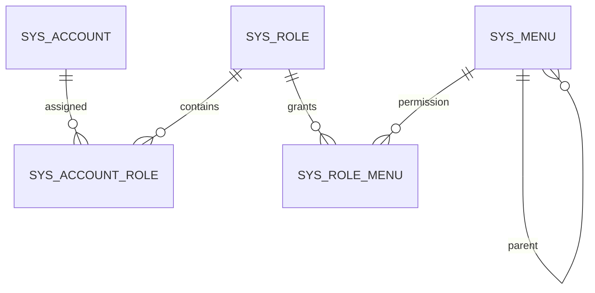

# RBAC 权限系统架构与生成指南

设计日期：2026-11-18。参考 `D:/phoenix-ops/sql/devops.sql`，本项目仅保存提取后的 DDL，不复制历史账号摘要、主机数据或登录日志。当前不执行数据库迁移，不验证实际 MySQL/Redis 连接。

## 模型与数据约定



账号—角色—权限采用两级多对多关系。sys_menu 同时表达目录、菜单和操作权限（type=1/2/3），code 是服务端授权依据；url 仅供导航，不直接构造服务端 SQL 或开放接口。菜单隐藏不等于无权限。parent_id=0 表示根节点，保存时检查祖先链，删除前必须先删除子菜单。

账号 enable=1 启用、0 禁用；lock=1 锁定、0 未锁定。角色 status=1 生效、0 禁用。原脚本管理员 lock=1 的含义存在历史歧义，迁移前必须审核，不能直接信任旧数据。数据库 admin 角色映射 ROLE_ADMIN；其余角色 code 转大写并加 ROLE_，权限码保持原样。

`sql/rbac-reference-schema.sql` 是六张原表 DDL；`sql/rbac-upgrade.sql` 是独立升级脚本，增加账号/角色/权限唯一键、关联唯一键与索引、查询索引及版本行。原脚本有重复角色菜单、历史孤儿关联和拼写不一致的 code，应用升级脚本前需人工清理重复、空值和孤儿，不提供自动删历史数据逻辑。原 UPDATE 请求方式改为 PUT，roleadd/menuadd 规范为 role:add/menu:add。新库直接执行 sql/rbac-schema.sql；已有原表执行 sql/rbac-upgrade.sql。两条路径互斥，不重复执行升级脚本。

## 分层实现

| 层 | 实现 |
| --- | --- |
| contract | AccountRequest、RoleRequest、MenuRequest、AssignmentRequest、PageResult，原生字段校验 |
| api | RbacController 与认证 Controller，HTTP 参数绑定与统一响应 |
| infra-dal | 生成的六组 Flex Entity/BaseMapper；独立 RbacRepository 维护参数化自定义 SQL |
| infra-integration | RbacCache，StringRedisTemplate + Fastjson2，固定 TTL |
| domain-service | RbacService 业务接口 |
| biz-impl | RbacServiceImpl 与内部 RbacOperations，七步模板、权限、OpsLog、事务与关联校验 |
| bootstrap | 数据库 UserDetailsService、动态权限门面、认证日志监听器、冲突响应 |

自定义查询集中在 RbacRepository，与生成目录隔离。当前复杂查询通过 JdbcTemplate 参数化执行，生成的 Flex Mapper 提供标准 CRUD 扩展入口；没有将现有查询换成依赖生成 TableDef 的 QueryWrapper。这样重新生成实体不会改变查询列、排序或关联条件。SQL 中表名和列名由代码白名单控制，值全部用 ? 绑定，分页限制 1~100，密码列只出现在内部认证查询，列表和详情不返回密码。

所有写操作位于 RbacOperations 声明式事务中，授权关系采用“整组替换”。唯一冲突/数据约束冲突返回 HTTP 409 + A0409。权限管理写操作需要 ROLE_ADMIN 或 rbac:admin 权限；授予 rbac:admin 本身是高权限操作，普通 sys:role:mod 不足以修改授权。

## 认证与授权

沿用 HTTP Basic 和 BCrypt，允许数据库账号登录。初始配置管理员仍作为数据库尚未初始化时的接入账号；其用户名是保留值，API 不允许创建或修改为该用户名。该账号不依赖数据库，拥有管理权限，必须严格控制环境凭据；数据库同名账号会被初始账号遮蔽。数据库账号密码摘要只从数据库加载，不写 Redis。

RbacPermission 每次方法权限检查重新检查账号是否存在、启用和锁定，随后读取当前版本的权限，避免会话中的旧权限继续访问 RBAC 接口。其他未来业务接口也应使用该门面；单独 hasAuthority 会使用会话已有权限，不能保证即时撤权。管理员文档/监控访问仍使用过滤链角色规则。

登录监听器记录认证成功/失败，不记录密码或密码摘要；日志写入失败记 error 并保留认证结果。Basic 每次认证可能产生一条日志，因此后续若接入登录会话端点需调整事件粒度。客户端 MAC 地址不采集，服务端无法可信获取浏览器设备 MAC。

## Redis 缓存设计

| 数据 | 缓存策略 | 理由 |
| --- | --- | --- |
| 用户生效角色与权限码 | `opshub:rbac:{version}:authorities:{accountId}`，60秒 | 高频授权读取，不包含密码 |
| 用户授权菜单（平铺，含 parentId） | `opshub:rbac:{version}:menus:{accountId}`，60秒 | 导航高频，前端按 parentId 构建树；仅显示已授权节点 |
| 账号密码摘要、启用/锁定状态 | 不缓存 | 状态和凭据即时生效，减少敏感数据驻留 |
| 管理分页列表、详情、关联编辑列表 | 不缓存 | 管理读写要求实时，查询组合多，命中收益低 |
| 登录日志、操作审计 | 不缓存 | 追加写及历史分页，数据库/日志通道是事实来源 |
| 全局权限版本 | 数据库版本行，不缓存 | 缓存失效失败时不继续使用旧权限 |

每次角色、菜单、账号或关联写事务递增 sys_rbac_version.version，提交后新请求读取新版本并使用新 key。旧版本 key 通过 TTL 自然清理，不用 KEYS/全库扫描，不依赖事务提交后的 Redis 删除成功。所有 RBAC 写必须经过服务或同步更新版本行；手工 SQL 修改必须在同一事务递增版本。

Redis 连接故障或缓存反序列化失败时回源数据库，数据库失败仍向上报错，不使用旧权限兜底。请求已经进行中的授权决定不能追溯撤回；状态检查与后续业务之间仍有常规并发窗口，关键资源业务需在自身事务中补充检查。当前全局版本策略适合运维平台低频管理写，规模增长时再拆角色/账号版本。

Redis 环境配置：REDIS_HOST、REDIS_PORT、REDIS_PASSWORD，连接/读取超时 2 秒；缓存保留时间写在 RbacCache 中。

## Swagger 调用

dev/test 开启 `/swagger-ui.html`，使用初始管理员 HTTP Basic 进入并 Authorize。写请求保留 CSRF：同一浏览器会话 GET `/auth/csrf`，把 data.token 保存为 `localStorage.setItem('opshub.csrf', token)`，Swagger UI 自动发送 X-CSRF-TOKEN。数据库暂不可达时文档仍可描述接口，但业务调用会返回数据库故障；不返回伪造的成功数据。

| 资源 | 接口 |
| --- | --- |
| 账号 | GET/POST `/rbac/accounts`，GET/PUT/DELETE `/rbac/accounts/{id}` |
| 角色 | GET/POST `/rbac/roles`，GET/PUT/DELETE `/rbac/roles/{id}` |
| 菜单权限 | GET/POST `/rbac/menus`，GET/PUT/DELETE `/rbac/menus/{id}` |
| 账号角色 | GET/PUT `/rbac/accounts/{id}/roles` |
| 角色权限 | GET/PUT `/rbac/roles/{id}/menus` |
| 当前权限/菜单 | GET `/rbac/me/permissions`、`/rbac/me/menus` |
| 登录日志 | GET `/rbac/login-logs`（仅查询） |

分页参数 page=1、size=20、keyword=""。账号新增示例：`{"username":"operator","password":"change-me-123","email":"operator@example.com","realName":"操作员","enable":1,"locked":0}`。更新时 password=null 表示不改密码；授权替换示例 `{"ids":[1,2],"version":0}`，空数组清空绑定。账号→角色→菜单权限需先创建实体再绑定，不隐式授权。

## 离线 MyBatis-Flex 生成器

运行 Java 源文件模式，无需数据库连接，也无需启动应用：

```powershell
java opshub-infra/opshub-infra-dal/src/main/java/com/nianliu/opshub/infra/dal/generator/RbacCodeGenerator.java sql/rbac-schema.sql D:/OpsHub-generation-preview
```

生成范围严格限定六张 RBAC 表：getter/setter 使用 Lombok，所有列显式 @Column，id 使用 @Id(KeyType.Auto)，识别新增 is_deleted/version 并配置逻辑删除、乐观锁注解、租户、分片或自动字段填充。保留数据库名 sys_*，不因 Java 驼峰、表前缀、全局主键策略而改变 SQL 列映射。作者和日期按生成当天填写。

当前源文件就是通过该生成器创建的。已有 Entity/Mapper 任意一个存在即拒绝覆盖；建议始终输出新目录后审核 diff，再合并新增列。生成器仅针对本项目 MySQL DDL 格式，不是通用 SQL 解析器。不会生成或覆盖 Controller、Service、自定义 SQL 和 Mapper XML，后续代码生成不会覆盖业务实现。不要把生成任务绑定到普通 compile 生命周期。

## 验证边界

本地 H2 MySQL 模式测试实际执行参数化查询、密码列隔离、授权关系去重和版本递增；离线生成测试验证字段注解和重复生成拒绝覆盖，OpenAPI 测试检查 RBAC 路径可见。实际数据库迁移、MySQL 执行计划和真实 Redis 网络连接不在本轮验证范围。

## 补充字段、逻辑删除与应用层关联完整性

账号、角色、菜单三张可变主表缺少 version 和 is_deleted，已在新库 DDL 和原库升级 SQL 中补齐：version BIGINT NOT NULL DEFAULT 0，is_deleted TINYINT NOT NULL DEFAULT 0（0有效、1删除）。关联表表示当前有效授权，采用物理删除；登录日志是不可变记录，不设置乐观锁或逻辑删除列，仅开放查询。

生成器根据 SQL 中实际字段识别 `@Column(value="version", version=true)` 和 `@Column(value="is_deleted", isLogicDelete=true)`。自定义 SQL 不依赖 ORM 自动改写，显式对账号、角色和菜单主表过滤 is_deleted=0，关联行物理删除；更新使用 id+version+is_deleted=0 条件，成功后 version+1。

修改账号/角色/菜单和替换授权时请求 body 必须携带详情返回的 version；新增可以不填。DELETE 使用 `?version=当前版本`。版本不一致返回 A0409，先刷新详情再修改。授权替换也推进账号或角色主行版本，避免两次并发整组覆盖。

逻辑删除实体时同步物理删除关联行；替换授权在事务中物理删除原关联后插入去重的新关联。唯一键保留被删用户名和权限码，不能通过逻辑删除绕过唯一性；未来若要允许复用需独立设计归档/唯一键策略。

所有 SQL 不创建 FOREIGN KEY。服务在同一写事务中先锁定 sys_rbac_version 单行，串行化 RBAC 图修改，然后校验实体存在且未删除、角色/菜单目标合法、菜单祖先无循环，再写入并推进版本。关联校验和删除不会因两个应用实例并发操作而越过检查。外部 SQL 写入也必须遵循版本行锁协议；数据库本身不替应用校验关系。高写入规模时可改为统一顺序锁定关联实体行，但当前管理面采用全局写锁简化一致性。

详细的分类理由、保留期和恢复限制见《RBAC数据删除策略.md》。

逻辑删除只通过主实体字段注解启用，移除全局 logic-delete-column 设置，避免对关联表和日志生成不存在的 is_deleted 查询条件。

当前分层以《分层架构调整.md》为准：Service 为 domain-service 中的业务接口，其实现和事务组件位于 biz-impl。
