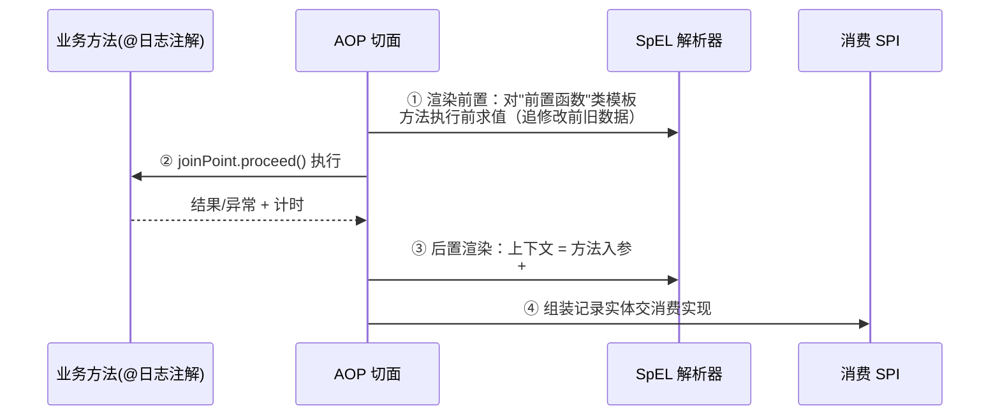

# REA 逆向工程分析报告 —— 操作日志与 SpEL 校验组件

> **REA（Reverse Engineering Analysis）**：对两个成熟开源组件做逆向分析，提炼其设计原理与
> 机制骨架，去除不适配部分后在 OpsHub 工程中**自研实现**为内建能力 —— 不引依赖、
> 不做代码搬运，只吸收设计。本报告全程不引用被分析项目的专有标识，只描述可通用化的机制结论。

| 项 | 说明 |
| --- | --- |
| 分析对象 A | 操作日志组件（注解 + AOP + SpEL 模板，SpringBoot starter 形态） |
| 分析对象 B | SpEL 校验组件（jakarta.validation 扩展形态） |
| 转化产出 | OpsLog 操作日志能力 + OpsValidator SpEL 校验能力（全部自研，落位见 §4.1） |
| 报告读者 | OpsHub 后续维护者：知道"为什么这么设计"，而不只是"怎么用" |

---

## 一、分析范围与方法

两个组件分别代表两类问题的成熟解：

- **操作日志**：把"谁在什么时间对什么数据做了什么"从业务代码里**声明化**出来 —— 注解写模板，切面统一取值渲染，输出进独立审计通道；
- **SpEL 校验**：jakarta 标准注解（@NotNull 等）表达不了的**字段间联动规则**（条件必填、联合区间、正则格式），用 SpEL 布尔断言补充，并保持标准校验报告流。

逆向提问清单（本报告按此展开）：注解模型是什么 → 切面/执行器的时序是什么 → 表达式求值怎么缓存 → 错误与报告怎么流 → SPI 在哪里 → 有什么可改良的瑕疵。

---

## 二、操作日志组件逆向分析

### 2.1 基本面

starter 形态（spring-boot-starter 依赖 + 自动装配类 + 配置属性），核心约 20 个类，引两个外部件（JSON 库、guava 的 Lists 工具方法）。

### 2.2 注解模型（声明面）

一个方法级注解，八个属性全面 SpEL 化：

| 属性 | 语义 | 备注 |
| --- | --- | --- |
| success / fail | 成功/失败时的内容模板 | 必填 success；支持 SpEL 占位 |
| module / type | 业务模块 / 操作类型 | type 常配常量（新增/修改/删除） |
| operator / tenant | 操作人 / 租户 | 缺省回落 SPI（IOperatorService） |
| bizNo | 关联业务编号 | 审计检索键 |
| detail | 补充详情 | 独立模板 |
| condition | 记录条件 | SpEL 布尔 |

**关键设计点**：注解属性只是**模板字符串** —— 渲染权在切面，声明与执行分离。

### 2.3 切面时序（执行面）



### 2.4 核心机制（值得吸收的四件）

1. **SpEL 求值缓存**（性能要害）：求值器继承 Spring 的 `CachedExpressionEvaluator`，
   以 `AnnotatedElementKey(方法, 类)` 为键、表达式串为子键，`ConcurrentHashMap` 缓存
   Expression 编译产物 —— 模板是编译期字面量，**首次编译之后零解析成本**。
2. **模板双形态**：`{funcName{#expr}}` 双层花括号 = 先求内层 SpEL 交给自定义函数；
   整串不含花括号时直接当 SpEL 表达式求值 —— 一套语法覆盖"取参"与"函数"两类诉求。
3. **方法入参绑定**：`MethodBasedEvaluationContext`（Spring 原生）+ 参数名反射 —— 模板
   可直接 `{#paramName.field}`；`#_result` / `#_errMsg` 以 variable 注入。
4. **两枚 SPI**：消费实现（存库/发 MQ 由业务方接管）+ 操作人实现（登录态注入）——
   框架与工程现状解耦，两个扩展点都留足演进位。

### 2.5 瑕疵与改良点（本工程做了什么）

| # | 分析发现的瑕疵 | OpsHub 转化改良 |
| --- | --- | --- |
| 1 | `condition` 以 `"false".equalsIgnoreCase(...)` 字符串比较判定 | 改为 SpEL 求值 Boolean，异常按"记录"处理（审计宁可多记） |
| 2 | 表达式解错时 warn 后回写原文 —— 与纯文本占位易混淆，问题静默 | 求值失败保留原文 + 带定位 warn（文件:方法），同时模板渲染整体零异常化 |
| 3 | 对象比对器（compare 包）**设计了但未接线**：切面从不填充 compareFields，字段级"原/新数据"能力空缺 | **补全闭环**：`diff` 属性 + 字段级 diff（name: 旧→新），并修好它的求值时序缺陷 |
| 4 | 前置函数契约未提示"引用共享"风险 | 前置取数接口写入**防御性副本硬性契约**（防业务原地修改污染修改前快照） |
| 5 | 引 guava 仅为一行列表工具 | 零额外依赖（fastjson2/commons 已有） |
| 6 | 复杂对象文本化 = toString()（打印对象哈希，无留档价值） | 文本化口径改为 JSON 序列化（简单类型直打） |

---

## 三、SpEL 校验组件逆向分析

### 3.1 基本面

多模块：core（引擎）+ javax/jakarta（两套入口适配）+ constrain（约束注解族）。
面向 JDK8+，与 bean validation 只做只增不改的扩展。

### 3.2 两级注解体系（关键机制 —— 没这一层就看不懂）

```text
┌─ 第一级：类级入口注解（jakarta 原生 @Constraint 通路）──────────────┐
│  @SpelValid(target TYPE) + validatedBy = SpelValidator             │
│  —— 走 Hibernate Validator 的标准类级约束分发，收到的 value 是      │
│     整个宿主对象（SpEL 以宿主为 root 的前提）                        │
└──────────┬───────────────────────────────────────────────────────┘
           │ 调用统一执行器
┌─ 第二级：字段级约束注解（不走 jakarta 通路！）───────────────────────┐
│  @SpelAssert / @SpelNotNull / ... 上挂自定义元注解 @SpelConstraint   │
│  （validatedBy=<执行器>）—— 纯声明元数据，由第一级的执行器扫描解释     │
└────────────────────────────────────────────────────────────────────┘
```

**为什么必须这样**：jakarta 的字段约束执行时把**字段值**传给 ConstraintValidator —— 传不到
宿主对象，SpEL 就无法引用兄弟字段（`#this.a == #this.b` 无从谈起）。类级注解收到宿主后，
自己扫字段、以宿主为 root 求值 —— 联动规则才成立。**这是整个组件存在的第一性原因**。

### 3.3 执行管线与缓存

- 执行器**静态字段缓存**：`Class → 含 Spel 约束的字段列表`（反射扫描每类只做一次）；
- **表达式编译缓存**：`串 → Expression`（编译期字面量，一次编译）；
- 组过滤（spelGroups）与 condition 两层开关；
- 违规结果按字段回填 jakarta `ConstraintValidatorContext`（propertyNode 定位）→
  复用标准 ConstraintViolation 报告流与异常体系。

### 3.4 瑕疵与改良点

| # | 分析发现的瑕疵/臃肿 | OpsHub 转化改良 |
| --- | --- | --- |
| 1 | 静态全局态满地（静态缓存 + 静态执行器 + BeanResolver 静态绑定） | 收敛为一个 ConstraintValidator 内的私有静态缓存，无全局状态外泄 |
| 2 | 约束注解族 14 个（大而全），元注解 + 实例管理器两层间接 | **两个注解收口**：@SpelAssert 通用断言（覆盖格式/长度/联合）+ @SpelNotBlank 条件必填（最高频场景独立成注解），执行器直接识别，扩展再解封 |
| 3 | 组过滤/消息插值/国际化全套支持 | 全部裁剪（管理平台中文单语 + 单组场景，简单原则） |
| 4 | 断言求值异常会作为校验框架异常外抛到产出 | 吸收其"显式暴露"内核并**落成明确口径**：condition 异常=不开启放行；assert 异常=不通过（歪守卫比无守卫更危险） |

---

## 四、OpsHub 转化设计

### 4.1 归属矩阵（编码规范 §2.4/§2.5 的落位答卷）

| 能力 | 落点模块 | 理由 |
| --- | --- | --- |
| @OpsLog / 模型 / SPI / SpEL 求值器 / diff 工具 | opshub-common（opslog 包） | 横切能力唯一定义点；业务模块（biz-impl）标注注解需传递可达 |
| @SpelValidated / @SpelAssert / @SpelNotBlank / 执行器 | opshub-common（validation 包） | 同上；校验注解按规范属"轻量校验注解"层 |
| OpsLogAspect 切面 + 两个默认 SPI 实现 + Banner Runner | opshub-bootstrap | 全局切面 + 装配唯一归属启动装配层（§2.7.1） |
| OP_LOG 审计通道（logs/oplog/·60d·2GB） | logback-spring.xml | 再证"接口实现分离"：消费 SPI 阶段②可整体换成审计表落库 |
| 演示业务（VO/Service/Controller/前置函数） | opshub-biz-impl（demo 包） | 接口实现层演示形态；VO 用普通注解组合非 spring 注解 |
| 依赖声明 | biz-impl / bootstrap **显式声明 opshub-common** | §2.4 规则 5"直接使用即显式声明"（详见 §4.3 排坑记录） |

### 4.2 与被分析组件的关键设计差异（速查）

| 维度 | 分析对象 A | OpsHub @OpsLog |
| --- | --- | --- |
| 占位语法 | `{{#x}}` 与 `{fn{#x}}` 混合 | `{#expr}` 模板（兼容双花括号写法）；函数机制独立化在 `before` 属性 |
| 修改前数据 | 前置函数任意链 | `before="{beanName{#expr}}"` 一个属性直达 + 防御性副本契约 |
| 字段级 diff | 设计未接线 | `diff` 属性生效，fieldChanges 结构化 + `#_diff`/`#_changedFields` 变量 |
| 文本化 | toString | 简单类型直打、复杂对象 JSON |
| 通道 | 交用户实现（starter 不带存储观点） | 自带 OP_LOG 审计通道的观点实现，SPI 可整体替换 |
| 条件 | 字符串 "false" 比较 | Boolean 求值，求值失败按"记录" |
| Banner | starter 配置 banner 开关 | 保留吸收：两组件 stdout banner（`opshub.banner.enable` 可关） |

| 维度 | 分析对象 B | OpsHub OpsValidator |
| --- | --- | --- |
| 入口 | @SpelValid 命名 | @SpelValidated（避免与语义近似的什么混淆，-ed 后缀屏表状态语义） |
| 注解族 | 14 个 | 2 个（Assert + NotBlank），断言全覆盖 |
| 错误流 | 回填 jakarta 上下文 | 相同（吸收） |
| 全局态 | 静态缓存盘 | 执行器私有持有 |

### 4.3 实施 NTs 中的两个机制级排坑记录（写入知识，防复发）

1. **深传递链解析断点**：业务模块直接引用 common 的类（操作日志注解）时，
   多级传递（bootstrap→biz-impl→biz-shared→domain-service→dal→common）出现解析断点
   （不同发行版 javac 均稳定复现"程序包不存在"）。**遵循 §2.4 规则 5 显式声明**
   后问题消失 —— 该规则不只是"规范洁癖"，它是工程可构建性的实保障。
2. **测试型源组合的 javac 解析怪癖**：注解数组 + 泛型键 Map + 字段初始化的特定源文件
   结构组合出现编译期引用解析异常；**结构改写**（构造器初始化字段、以 List 建立注解与
   快照的索引对应）后编译稳定。教训：横切框架代码优先选择朴素直白的语言结构。

---

## 五、使用手册（OpsHub 内建能力怎么用）

### 5.1 @OpsLog 模板速查

| 写位置 | 语法 | 例 |
| --- | --- | --- |
| SpEL 取值 | `{#param.field}`（兼容 `{{#param.field}}`） | `{#req.name}` |
| 返回值/异常 | `{#_result}` / `{#_errMsg}` | `新增成功: {#_result}` |
| 纯表达式模板 | 不含花括号的属性整体按 SpEL 求值 | `"'共' + #list.size + '条'"` |
| 前置取数 | `before = "{beanName{#expr}}"` | `before = "{userBefore{#req.id}}"` |
| diff | `diff = "<新对象 SpEL>"` | `diff = "#_result"` |
| 内置变量（diff 后） | `#_before`、`#_changedFields`、`#_diff`、`#_cost` | 见下三例 |

### 5.2 三种审计叙事（实测落盘样例）

```java
// 新增 —— 细节引自返回值
@OpsLog(module = "用户管理", type = OpsLogType.ADD, bizNo = "{#_result.id}",
        success = "新增了一个用户：{#req.name}，详细信息: {#_result}")

// 修改 —— before 取旧数据 + diff 自动字段级对比
@OpsLog(module = "用户管理", type = OpsLogType.UPDATE,
        before = "{userBefore{#req.id}}", diff = "#_result", bizNo = "{#req.id}",
        success = "修改 [{#_changedFields}] 的值，原数据: {#_before}，新数据: {#_result}")

// 删除 —— 前置取数留档被删明细
@OpsLog(module = "用户管理", type = OpsLogType.DELETE,
        before = "{userBefore{#id}}", bizNo = "{#id}",
        success = "删除了 [用户表] 中主键ID为 {#id} 的信息，详细信息: {#_before}")
```

冒烟实测（OP_LOG 通道 JSON 行,已v验证）：

```text
新增 → content: "新增了一个用户：Mr.Wang，详细信息: {...status=ACTIVE}"
修改 → content: "修改 [name, phone] 的值，原数据: {...Mr.Wang...}，新数据: {...Mr.Wang2...}"
        fieldChanges: [{"fieldName":"name","oldValue":"Mr.Wang","newValue":"Mr.Wang2"},
                       {"fieldName":"phone","oldValue":"13800138000","newValue":"13900139000"}]
删除 → content: "删除了 [用户表] 中主键ID为 1001 的信息，详细信息: {...}"
operator: "Mr.Wang"（来自 X-Operator 请求头，SPI 可替换为登录态）
```

### 5.3 @SpelValidated 校验速查

```java
@SpelValidated
public class UserCreateRequest {
    @NotBlank                                      // jakarta 原生照常共存
    private String name;

    @SpelAssert(assertTrue = "#this.phone == null || #this.phone.matches('^1[3-9][0-9]{9}$')",
                message = "手机号格式不合法")        // 格式断言
    private String phone;

    @SpelNotBlank(condition = "#this.isolationEnabled == true",
                message = "开启实例隔离时必须填写隔离说明") // 条件必填
    private String isolationDesc;
}
// Controller 侧不变式：@Valid 参数 —— 违规并入标准 ConstraintViolation 报告流（400）
```

### 5.4 配置项

| 配置 | 默认 | 说明 |
| --- | --- | --- |
| `opshub.banner.enable` | true | 启动组件横幅开关（stdout，不进日志通道） |
| 日志通道 | - | OP_LOG 命名 Logger：logs/oplog/*.log，60 天/2GB，additivity=false |

### 5.5 前置函数契约（实现 OpsLogBeforeFunction 时必读)

1. **防御性副本**（硬性）：find() 返回对象不得是可变 live 引用 —— 内存态实现必须手工复制；
   走 DB SELECT 的实现天然满足；
2. **主键/缓存点查**（性能契约，§18.10）：与业务同线程，禁止重查询；
3. 只在需要审计"修改前/删除前"留档的方法上声明 before —— 明细类打印的事前posing要有计量意识。

---

## 六、端到端验证摘要（2026-11-17 实测）

| 验证项 | 结果 |
| --- | --- |
| 全量构建（14 模块 + Enforcer 收敛） | ✅ BUILD SUCCESS |
| 应用启动 + 双组件 banner | ✅ 1.4s 启动，stdout 双横幅 |
| 新增合法数据 → 审计通道"新增了一个用户" | ✅ |
| 手机号格式断言拦截 | ✅ HTTP 400 |
| 条件必填拦截（开关字段联动） | ✅ HTTP 400 |
| 修改 → 字段级 diff（原/新数据 + fieldChanges） | ✅ name/phone 双变更正确留档 |
| 删除 → 修改前快照留档 | ✅ |
| 操作人注入 | ✅ X-Operator 请求头 → operator 字段 |

---

> **方法论收口**：REA 的价值不是"抄设计"，而是把别人踩过的坑变成自己的规约 ——
> 本轮吸收了表达式缓存/类级入口扫描/SPI 解耦三个机制内核，Improve 了条件判定、
> diff 时序、快照契约、文本化四个实际缺陷，并裁剪了组过滤/消息插值等我们用不上的复杂度。
> 操作日志与校验的后续演进（审计表落库、登录态注入、约束族扩展）都有明确落位，接口稳定 + 实现可替。
