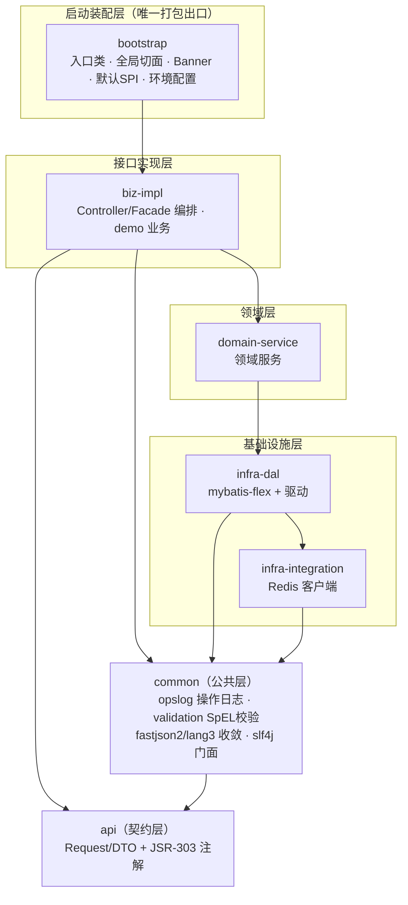
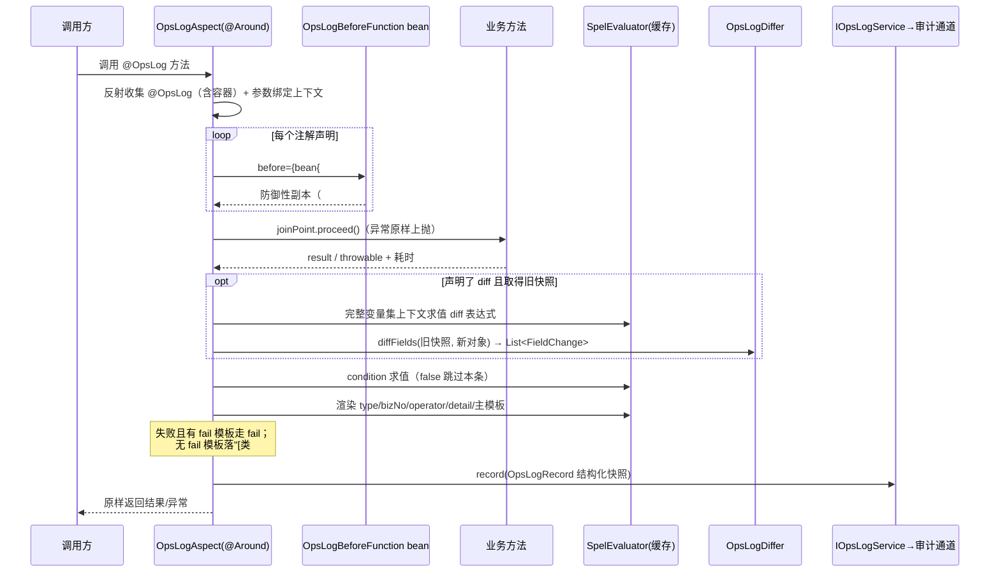
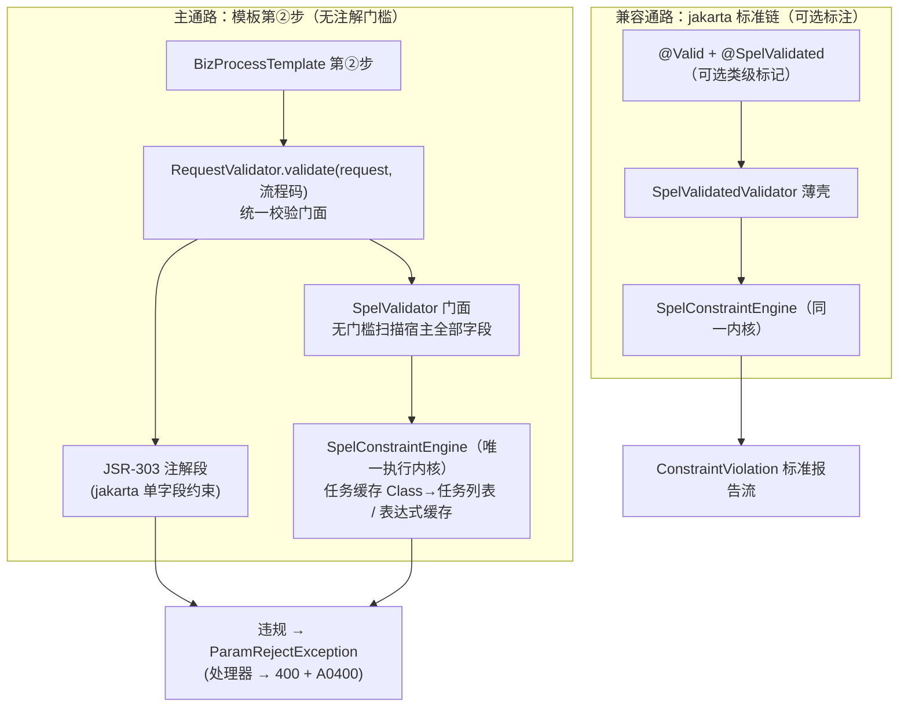

# OpsHub 工程实现复现手册

> **手册定位**：这是一份<b>自包含</b>的实现复现指南 —— 目标读者是"要在另一个空白系统里
> 重建同款工程"的工程师。按章节顺序照做，即可复现本工程的结构设计（分层依赖治理）、
> 业务操作日志审计（@OpsLog + 字段级 diff）、SpEL 数据校验（**模板显式触发 + 分组分组校验**）、
> 统一接入模板（七步编排）、统一响应/异常信封、组件 Banner 与预热、通道化日志与全部配置体系。
>
> **配套文档**（决策论证不在本手册重复，按需查阅）：
> 《系统设计方案》——技术选型方法论；《日志通道设计说明》——日志路由机制详解；
> 《REA分析-操作日志与SpEL校验》——能力设计来源与改良记录；
> 《Spring依赖CVE缓解评估》——Spring 版本治理决策。

## 文档版本记录（会话演进）

| 版本 | 范围 | 要点 |
| --- | --- | --- |
| v1.0 | 骨架/操作日志/校验/日志/配置 | 初版：五层 Maven 骨架、@OpsLog 审计、SpEL 校验组件、五通道日志、fastjson2 唯一实现、Banner |
| v1.1 | 统一响应与异常 | Result 信封 + OpsException/OpsErrorCodes + 全局异常处理器（HTTP 双轨口径 200/400/500）；沉淀 advice 落位铁则（与启动类同包 + 裸 @ControllerAdvice —— 环境扫描怪癖的矩阵探针实测结论） |
| v1.2 | 统一接入模板 | 编码规范 §8.3 七步模板落地 biz-shared：流程码/降级守卫/幂等兜底/收尾；demo 业务全量模板化 |
| v1.3 | 校验触发改造 | 触发权从 @SpelValidated 入口注解收敛到模板第②步显式调用（RequestValidator 门面 + SpelConstraintEngine 唯一内核）；VO 零入口注解 |
| v1.4 | 分组校验 + 启动预热 | @SpelAssert/@SpelNotBlank 增加 groups 分组（内建 Create/Update/Delete/Query 组，模板回调 validationGroups 声明请求组）；ValidationPreheat 按 §2.7.1.1 五原则预热 JSR-303 工厂/任务扫描/表达式编译；引擎三防线（平台类型短路等，修复 Long 型请求 500） |

---

## 一、复现目标与全景

### 1.1 能力验收清单（复现完成后逐项核对）

| # | 能力 | 验收方式 |
| --- | --- | --- |
| 1 | 五层多模块 Maven 工程（依赖严格单向、Enforcer 收敛校验） | §2 骨架 + `mvn install` 全绿 |
| 2 | 无漏洞版本依赖基线（含版本统一登记机制） | §2.2 版本表 + Enforcer 规则 |
| 3 | **业务操作日志审计**：`@OpsLog` 注解 → SpEL 模板 → 前置取数 → 字段级 diff → 审计通道 | §3 全部 + §7.2 用例 ①②③ |
| 4 | **SpEL 数据校验（模板显式触发）**：无入口注解门槛 + 条件必填/联合断言 + 分组校验 | §4 全部 + §7.2 用例 ②③ |
| 5 | 五通道异步日志（biz/monitor/dal/oplog/error）+ 磁盘保护 | §5 配置全文 |
| 6 | 组件启动 Banner + 配置开关 | §6.4 + 启动日志 |
| 7 | 多环境配置（dev 锚定工程根 / prod 凭据 fail-fast） | §6.1~6.3 |
| 8 | **统一响应信封 + 全局异常处理**（Result/OpsException/双轨 HTTP 口径） | §8 全部 + §7.2 用例 ②⑤ |
| 9 | **统一接入模板**：七步编排/流程码/降级/幂等兜底/分组透传 | §9 全部 + §7.2 用例 ④⑥ |
| 10 | **启动预热**（JSR-303 工厂 + SpEL 任务/表达式前移） | §4.3 + 启动日志"校验预热完成" |

### 1.2 工程全景（模块结构与依赖方向）



> 分层铁律（复现时不可妥协）：依赖严格单向；**直接使用某模块的类必须在自身 POM
> 显式声明**（见 §2.4 的真实踩坑）；三方件只在 common / infra / 装配层 starter 引入。

---

## 二、工程骨架复现（Maven 多模块）

### 2.1 目录结构

```text
工程根/
├── pom.xml                        # 父 POM：版本统一登记 + compiler 注解处理器 + enforcer
├── api/                           # opshub-api 接口契约层（独立版本发布）
├── common/                        # opshub-common 公共层（opslog/validation/slf4j/fastjson2 收敛）
├── bootstrap/                     # opshub-bootstrap 启动装配（入口+切面+SPI 实现+资源过滤）
├── biz/                           # 聚合父 POM（纯 pom）
│   └── biz-impl/                  # Controller + demo 业务 + VO
├── domain/                        # 聚合父 POM
│   ├── domain-model/              # 领域模型（零依赖）
│   └── domain-service/            # 领域服务
├── infra/                         # 聚合父 POM
│   ├── infra-dal/                 # mybatis-flex + 驱动 + jdbc starter
│   └── infra-integration/         # spring-boot-starter-data-redis
└── docs/                          # 全部设计与决策文档
```

### 2.2 根 POM 关键节选（版本唯一登记地）

```xml
<properties>
    <java.version>21</java.version>
    <maven.compiler.release>21</maven.compiler.release>
    <!-- ……内部模块各自独立发布版本号（api 1.0.0 等）…… -->
    <spring.boot.version>3.5.16</spring.boot.version>      <!-- 选型与 CVE 治理见《Spring依赖CVE缓解评估》 -->
    <mybatis.flex.version>1.11.8</mybatis.flex.version>
    <fastjson2.version>2.0.66</fastjson2.version>
    <commons.lang3.version>3.22.0</commons.lang3.version>   <!-- ≥3.18.0：修复 CVE-2025-48924 -->
    <lombok.version>1.18.48</lombok.version>
    <mapstruct.version>1.6.3</mapstruct.version>
    <lombok.mapstruct.binding.version>0.2.0</lombok.mapstruct.binding.version>
    <mysql.version>26.10.0</mysql.version>
</properties>

<dependencyManagement>
    <dependencies>
        <!-- ① Spring Boot 官方 BOM：spring 全家桶版本统一裁决（子模块引 starter 一律不带版本号） -->
        <dependency>
            <groupId>org.springframework.boot</groupId>
            <artifactId>spring-boot-dependencies</artifactId>
            <version>${spring.boot.version}</version>
            <type>pom</type>
            <scope>import</scope>
        </dependency>
        <!-- ② 内部模块坐标登记（各 <version>${xxx.release.version}</version>）…… -->
        <!-- ③ 三方件逐一登记（fastjson2 / commons-lang3 / lombok / mapstruct /
                mybatis-flex-spring-boot3-starter / mysql-connector-j / testng）…… -->
    </dependencies>
</dependencyManagement>

<build>
    <plugins>
        <!-- 编译器：全工程统一注解处理器，顺序不可颠倒（lombok 先生成访问器，mapstruct 后感知） -->
        <plugin>
            <groupId>org.apache.maven.plugins</groupId>
            <artifactId>maven-compiler-plugin</artifactId>
            <version>3.16.0</version>
            <configuration>
                <release>${maven.compiler.release}</release>
                <parameters>true</parameters>   <!-- 保留参数名：SpEL 按参数名取值的前提 -->
                <annotationProcessorPaths>
                    <path>
                        <groupId>org.projectlombok</groupId>
                        <artifactId>lombok</artifactId>
                        <version>${lombok.version}</version>
                    </path>
                    <path>
                        <groupId>org.mapstruct</groupId>
                        <artifactId>mapstruct-processor</artifactId>
                        <version>${mapstruct.version}</version>
                    </path>
                    <path>
                        <groupId>org.projectlombok</groupId>
                        <artifactId>lombok-mapstruct-binding</artifactId>
                        <version>${lombok.mapstruct.binding.version}</version>
                    </path>
                </annotationProcessorPaths>
            </configuration>
        </plugin>
        <!-- Enforcer：版本收敛 + 同能力唯一实现 —— 构建期拦截，不靠人盯 -->
        <plugin>
            <groupId>org.apache.maven.plugins</groupId>
            <artifactId>maven-enforcer-plugin</artifactId>
            <version>3.1.0</version>
            <executions>
                <execution>
                    <id>enforce-dependency-rules</id>
                    <goals><goal>enforce</goal></goals>
                    <configuration>
                        <rules>
                            <dependencyConvergence/>
                            <bannedDependencies>
                                <excludes>
                                    <exclude>log4j:log4j</exclude>
                                    <exclude>commons-logging:commons-logging</exclude>
                                </excludes>
                            </bannedDependencies>
                        </rules>
                    </configuration>
                </execution>
            </executions>
        </plugin>
    </plugins>
    <pluginManagement>
        <plugins>
            <plugin>   <!-- repackage 版本随 BOM -->
                <groupId>org.springframework.boot</groupId>
                <artifactId>spring-boot-maven-plugin</artifactId>
                <version>${spring.boot.version}</version>
            </plugin>
        </plugins>
    </pluginManagement>
</build>
```

### 2.3 模块依赖矩阵（每个模块 POM 的直接依赖）

| 模块（按创建顺序） | 内部依赖 | 三方件（compile，除注明外） |
| --- | --- | --- |
| api | 无 | jakarta.validation-api；lombok（provided） |
| domain-model | 无 | lombok（provided） |
| common | api；domain-model | spring-context（SpEL 基建）；slf4j-api；fastjson2；commons-lang3；lombok（provided） |
| infra-integration | common | spring-boot-starter-data-redis；lombok（provided） |
| infra-dal | domain-model；common；infra-integration | mybatis-flex-spring-boot3-starter；spring-boot-starter-jdbc（**必须，否则 Hikari 不装配**）；mysql-connector-j（runtime）；mapstruct；lombok（provided） |
| domain-service | domain-model；infra-dal；infra-integration | lombok（provided） |
| biz-shared | domain-service | mapstruct；lombok（provided） |
| biz-impl | biz-shared；api；domain-service；**common（显式）**；**jakarta.validation-api（显式）** | spring-web；spring-context；lombok（provided） |
| bootstrap | biz-impl；**common（显式）** | spring-boot-starter-web（exclusion starter-json）；fastjson2-extension-spring6；spring-boot-starter-aop；spring-boot-starter-validation |

### 2.4 两条用真实踩坑换来的规则（务必固化在复现工程）

1. **直接使用即显式声明**：bootstrap/biz-impl 直接引用 common 的 opslog/validation 注解时，
   曾出现"多级传递（bootstrap→biz-impl→biz-shared→domain-service→dal→common）解析断点"
   （javac 报"程序包不存在"，多个 JDK 发行版稳定复现）—— 显式声明后消失。
   传递依赖只作"运行时可见"保障，**编译期用到的类一律显式声明坐标**。
2. **JSON 能力唯一实现**：web starter 默认 Jackson 必须 exclusion（`spring-boot-starter-json`），
   HTTP 层用 fastjson2 的 `fastjson2-extension-spring6` 转换器顶替（见 §6.3）——
   否则"同能力双实现"违反依赖治理基线且序列化口径分裂。

---

## 三、业务操作日志审计（@OpsLog）复现

### 3.1 组件全景（common 的 `opslog` 包 + bootstrap 装配）

| 文件 | 职责 |
| --- | --- |
| `OpsLog` / `OpsLogs` | 方法级注解（可重复容器）：8 属性模板 + before/diff 声明 |
| `OpsLogType` | 操作类型常量（ADD/UPDATE/DELETE/QUERY —— 文本而非枚举，审计列稳定） |
| `OpsLogRecord` | 结构化审计载体（operator/module/type/bizNo/content/details/costMs/fieldChanges/toJson） |
| `FieldChange` | record：字段名 + 旧值 + 新值（字段级 diff 结果） |
| `IOpsLogService` | 消费 SPI（默认落审计通道；可替换为审计表/MQ） |
| `IOperatorProvider` | 操作人 SPI（默认取 X-Operator 请求头；可替换登录态） |
| `OpsLogBeforeFunction` | 前置取数 SPI（**防御性副本硬性契约**，见 §3.7） |
| `OpsLogSpelEvaluator` | SpEL 求值核：表达式编译缓存 + 求值宽容化 + JSON 文本化 |
| `OpsLogTemplateParser` | 模板渲染器：花括号占位正则 + 纯表达式两形态 |
| `OpsLogDiffer` | 对象字段级对比（BigDecimal compareTo / 复杂类型序列化判等） |
| `OpsLogBanner` | 组件横幅（§6.4） |
| bootstrap `OpsLogAspect` | AOP 切面（执行时序主干） |
| bootstrap `DefaultOpsLogService` / `DefaultOperatorProvider` | SPI 默认实现 |

### 3.2 注解模型（完整定义）

```java
@Target(ElementType.METHOD)
@Retention(RetentionPolicy.RUNTIME)
@Documented
@Repeatable(OpsLogs.class)
public @interface OpsLog {
    String success();             // 成功模板（必填）
    String fail()         default "";   // 失败模板；缺省时失败落兜底文案
    String module()       default "";   // 业务模块（固定文本）
    String type()         default "";   // 操作类型（支持 SpEL，常取 OpsLogType 常量）
    String operator()     default "";   // 操作人 SpEL；空回落 IOperatorProvider
    String bizNo()        default "";   // 关联业务编号 SpEL
    String detail()       default "";   // 详情补充模板
    String condition()    default "";   // 记录条件 SpEL（false 跳过；空恒记）
    String before()       default "";   // 前置取数：{beanName{#expr}} 函数形态，或纯 SpEL
    String diff()         default "";   // 字段级 diff 的"新对象"SpEL（默认可写 #_result）
}
```

**模板语法**（三形态）：

| 形态 | 写法 | 说明 |
| --- | --- | --- |
| 占位取值 | `{#req.name}`（兼容 `{{#req.name}}`） | 花括号内 SpEL，渲染时替换 |
| 纯表达式 | 无花括号的整串按 SpEL 求值 | 如 `"'共'+#list.size+'条'"` |
| 内置变量 | `{#_result}` `{#_errMsg}` `{#_cost}` `{#_before}` `{#_changedFields}` `{#_diff}` | 返回值/异常消息/耗时/修改前快照/变更字段名/变更描述 |

### 3.3 切面执行时序（核心流程图）



### 3.4 关键实现代码节选① —— SpEL 求值核（性能要害）

```java
public class OpsLogSpelEvaluator extends CachedExpressionEvaluator {

    /** 表达式编译缓存：( 方法键, 表达式 ) → Expression——编译期字面量一次编译全周期复用 */
    private final Map<ExpressionKey, Expression> expressionCache = new ConcurrentHashMap<>(64);

    public EvaluationContext createContext(Method method, Object[] args, Map<String, Object> extraVars) {
        MethodBasedEvaluationContext context =       // Spring 原生：方法入参按名绑定（编译器 -parameters）
                new MethodBasedEvaluationContext(null, method, args, getParameterNameDiscoverer());
        if (extraVars != null) {
            extraVars.forEach(context::setVariable);
        }
        return context;
    }

    /** 求值：异常不外抛（WARN + 返回原文，排障时坏表达式肉眼可见） */
    public Object evaluate(String expression, AnnotatedElementKey methodKey, EvaluationContext evalContext) {
        try {
            return getExpression(expressionCache, methodKey, expression).getValue(evalContext);
        } catch (Exception e) {
            logger.warn("OpsLog SpEL 求值失败@evaluate 表达式:{}, 方法:{}, 原因:{}", expression, methodKey, e.getMessage());
            return expression;
        }
    }

    /** 文本化口径：简单类型直打；复杂对象走 fastjson2 序列化（对象哈希无留档价值） */
    public String evaluateToText(String expression, AnnotatedElementKey methodKey, EvaluationContext evalContext) {
        Object value = evaluate(expression, methodKey, evalContext);
        if (value == null) return "";
        if (value instanceof String || value instanceof Number || value instanceof Boolean
                || value instanceof java.time.temporal.Temporal || value instanceof java.util.Date) {
            return String.valueOf(value);
        }
        return JSON.toJSONString(value);
    }

    /** condition 求值：求值失败按 true 处理（审计宁可多记不可漏记） */
    public boolean evaluateToBool(String expression, AnnotatedElementKey methodKey, EvaluationContext evalContext) {
        try {
            Boolean value = getExpression(expressionCache, methodKey, expression).getValue(evalContext, Boolean.class);
            return value == null || value;
        } catch (Exception e) {
            logger.warn("OpsLog condition 求值失败...按记录 true 处理");
            return true;
        }
    }
}
```

### 3.5 关键实现代码节选② —— 模板渲染器（双形态归一）

```java
public class OpsLogTemplateParser {

    /** 占位匹配：交替匹配 "{{spel}}"（组1）或 "{spel}"（组2），花括号内无嵌套 —— 一次匹配即完整占位 */
    private static final Pattern PLACEHOLDER = Pattern.compile("\\{\\{([^{}]+)}}|\\{([^{}]+)}");

    private final OpsLogSpelEvaluator evaluator;

    public String render(String template, AnnotatedElementKey methodKey, EvaluationContext evalContext) {
        if (template == null || template.isEmpty()) {
            return "";
        }
        Matcher matcher = PLACEHOLDER.matcher(template);
        if (!matcher.find()) {
            return evaluator.evaluateToText(template, methodKey, evalContext);  // 纯表达式形态
        }
        matcher.reset();
        StringBuilder rendered = new StringBuilder(template.length() + 32);
        int cursor = 0;
        while (matcher.find()) {
            String expr = matcher.group(1) != null ? matcher.group(1) : matcher.group(2);
            rendered.append(template, cursor, matcher.start());
            rendered.append(evaluator.evaluateToText(expr.trim(), methodKey, evalContext));
            cursor = matcher.end();
        }
        rendered.append(template.substring(cursor));
        return rendered.toString();
    }
}
```

### 3.6 关键实现代码节选③ —— 切面主干（时序骨架）

```java
@Aspect
@Component
public class OpsLogAspect implements BeanFactoryAware {

    /** 前置函数声明形态：{beanName{#expr}} */
    private static final Pattern BEFORE_FUNC_PATTERN = Pattern.compile("\\{\\s*(\\w+)\\s*\\{([^{}]+)}}");

    // 构造注入 IOpsLogService / IOperatorProvider；new 求值器与渲染器；
    // BeanFactoryAware 保存 beanFactory（备查前置函数 bean）

    @Pointcut("@annotation(...OpsLog) || @annotation(...OpsLogs)")
    public void opsLogPointcut() { }

    @Around("opsLogPointcut()")
    public Object around(ProceedingJoinPoint joinPoint) throws Throwable {
        Method method = ((MethodSignature) joinPoint.getSignature()).getMethod();
        List<OpsLog> annotations = findOpsLogs(method);          // 含可重复容器展开
        if (annotations.isEmpty()) {
            return joinPoint.proceed();
        }
        AnnotatedElementKey methodKey = new AnnotatedElementKey(method, AopUtils.getTargetClass(joinPoint.getTarget()));

        // ① 前置取数（按注解独立，副本契约见 §3.7）
        List<Object> snapshots = new ArrayList<>(annotations.size());
        for (OpsLog annotation : annotations) {
            snapshots.add(resolveBefore(annotation, method, joinPoint.getArgs(), methodKey));
        }

        long begin = System.currentTimeMillis();
        Object result = null;
        Throwable failure = null;
        try {
            result = joinPoint.proceed();                        // ② 异常原样上抛（铁律）
        } catch (Throwable e) {
            failure = e;
            throw e;
        } finally {
            long cost = System.currentTimeMillis() - begin;
            try {                                                 // ③ 记录环节零外溢
                for (int i = 0; i < annotations.size(); i++) {
                    recordOne(annotations.get(i), ..., snapshots.get(i));
                }
            } catch (Throwable logError) {
                logger.warn("OpsLog 切面记录失败@around...");
            }
        }
        return result;
    }

    // recordOne 内关键顺序（**diff 时序易错，按此复刻**）：
    //   vars = {_result, _errMsg, _cost, _before}
    //   → 用完整 vars 上下文求值 diff 表达式（{#_result} 直接可用）→ diffFields(旧快照, 新对象)
    //   → 回填 vars{_changedFields, _diff} → condition 判定 → 渲染各属性 → 组装 OpsLogRecord
    //   → 有 fail 模板走 fail；无模板落 "[类#方法] 执行失败: msg" 兜底 → opsLogService.record(record)
}
```

### 3.7 前置取数契约与已修复的两个机制缺陷（复现时必读）

1. **防御性副本（硬性契约）**：`OpsLogBeforeFunction.find()` 不得返回可变 live 引用 ——
   业务原地修改会把"#_before 修改前快照"连同污染（真实 DB SELECT 每次新实体天然满足；
   **内存 Map/本地缓存实现必须手工复制**）。演示工程曾踩：修改审计的"原数据"打印出了修改后数据。
2. **diff 求值时序**：diff 表达式必须在**完整变量集**（含 `#_result`）上下文中求值 ——
   若先求 diff 再注入 `_result`，`diff = "#_result"` 会拿到 null 降级为整体快照对比。
3. **快照容器**：多注解各自持有 before 副本，以“注解下标 ↔ 快照下标”的 List 对应
   （**不建议** `Map<注解, Object>` 泛型键形态 —— 曾触发 javac 组合性解析问题，见 §2.4）。

### 3.8 操作人默认装配（bootstrap）

```java
@Component
public class DefaultOperatorProvider implements IOperatorProvider {
    static final String OPERATOR_HEADER = "X-Operator";
    static final String SYSTEM_OPERATOR = "system";

    @Override
    public String getOperator() {
        if (RequestContextHolder.getRequestAttributes() instanceof ServletRequestAttributes attributes) {
            String operator = attributes.getRequest().getHeader(OPERATOR_HEADER);
            if (StringUtils.hasText(operator)) return operator;
        }
        return SYSTEM_OPERATOR;   // 非请求上下文（调度/系统自检）占位
    }
}
```

审计消费默认实现（`DefaultOpsLogService`）：`LoggerFactory.getLogger("OP_LOG")` +
`OP_LOG.info("{}", record.toJson())`—— 落独立审计通道（§5）；消费侧异常仅 error 不外溢
（审计完整性红线 + 不影响业务）。阶段②整体替换为审计表即可，注解与切面零改动。

### 3.9 业务用法（三种审计叙事，实测可抄写）

```java
// 新增 —— 详细信息引自返回值
@OpsLog(module = "用户管理", type = OpsLogType.ADD,
        bizNo = "{#_result != null ? #_result.id : null}",
        success = "新增了一个用户：{#req.name}，详细信息: {#_result}")
public UserRecord createUser(UserCreateRequest req) { ... }

// 修改 —— before 前置取数 + diff 字段级对比
@OpsLog(module = "用户管理", type = OpsLogType.UPDATE,
        before = "{userBefore{#req.id}}",          // bean 名 userBefore 的 OpsLogBeforeFunction
        diff = "#_result",                          // 与修改前快照对比的"新对象"
        bizNo = "{#req.id}",
        success = "修改 [{#_changedFields}] 的值，原数据: {#_before}，新数据: {#_result}",
        fail = "修改失败：{#_errMsg}")
public UserRecord updateUser(UserUpdateRequest req) { ... }

// 删除 —— 被删记录全量留档
@OpsLog(module = "用户管理", type = OpsLogType.DELETE,
        before = "{userBefore{#id}}",
        bizNo = "{#id}",
        success = "删除了 [用户表] 中主键ID为 {#id} 的信息，详细信息: {#_before}")
public UserRecord deleteUser(Long id) { ... }
```

前置函数注册（业务侧）：

```java
@Component("userBefore")
public class UserBeforeFunction implements OpsLogBeforeFunction {
    @Override
    public Object find(Object key) {
        UserRecord original = ... // 主键点查
        return original == null ? null : copyOf(original);   // 防御性副本（契约）
    }
}
```

---

## 四、SpEL 数据校验（OpsValidator）复现

### 4.1 触发方式（改造后)：模板显式触发为主、注解链为兼容



**关键改造点**：触发权从"类级入口注解"回到**模板第②步的显式调用** ——
宿主类**无需标注 `@SpelValidated`**，字段上的 `@SpelAssert`/`@SpelNotBlank` 即被发现执行；
`@SpelValidated` 退化为**可选兼容标记**（需要 jakarta 标准 ConstraintViolation 流的场景使用），
两条通路共享 `SpelConstraintEngine` 唯一内核（任务缓存/表达式缓存/求值口径一致）。

### 4.2 分组校验（「新增才校 / 修改才校」）

**三层声明协作**：

```java
// ① 约束侧：字段约束声明所属组（空 = 全场景无条件生效）
@SpelAssert(assertTrue = "#this.status == null || #this.status == 'ACTIVE' || #this.status == 'FROZEN'",
        groups = ValidationGroups.Update.class, message = "状态仅允许 ACTIVE/FROZEN")
private String status;

// ② 请求侧：模板回调声明本次请求组（ 空 = 不启用组筛选）
@Override
public Class<?>[] validationGroups() {
    return new Class<?>[] {ValidationGroups.Update.class};
}

// ③ 引擎判定：请求组为空 → 全部约束执行；非空 → 「无条件约束」或「约束组 ∩ 请求组 ≠ 空」者执行
//    jakarta 段（@NotBlank 等）走原生 groups 语义透传，两段口径一致。
```

**内建组**（common/validation/`ValidationGroups`）：`Create` / `Update` / `Delete` / `Query`
四个标记接口；业务自建组按域声明（如 `OrderValidationGroups.Reject`），组的语义对外稳定。
实测：`update + status=BAD` → `400 "SpEL 校验未通过@USER_UPDATE status: 状态仅允许 ACTIVE/FROZEN"`。

### 4.3 启动预热（编码规范 §2.7.1.1 五原则落地）

`bootstrap/preheat/ValidationPreheat`（InitializingBean 钩子，启动期自动执行）：

| 预热项 | 内容 | 价值 |
| --- | --- | --- |
| JSR-303 工厂 | jakarta ValidatorFactory/校验器实例静态初始化前移 | 首校验不再承担工厂构建 |
| SpEL 约束任务 | 按配置类清单预扫 Class → 任务列表（含分组成员） | 首校验不再反射扫描 |
| SpEL 表达式编译 | 任务断言/条件表达式预编译入缓存 | 首校验无 AST 构建毛刺 |

- 配置位：`opshub.validation.preheat.classes`（全限定类名，逗号分隔，公共 yml 常驻）；
- 三条运行纪律：幂等（命中缓存即返回）、**失败不阻断启动**（逐项 catch + warn）、
  StopWatch 耗时打点（启动日志`校验预热完成. 明细:StopWatch...`）；
- 引擎健壮性三防线（实测产出）：**平台类型短路**（java.*/jakarta.*/基本类型直接空任务——
  JDK 强封装禁止对 java.base 反射；demo 的 Long 型请求曾在此 500）、**扫描整体容错**、
  **单字段反射受限跳过** —— 防御"一条校验链被一个不可扫类型炸掉"。

### 4.4 组件与注解速查（当前真实形态）

**common/validation 五件套**：

| 件 | 形态 | 职责 |
| --- | --- | --- |
| `SpelConstraintEngine` | 包内静态引擎（唯一内核） | 任务扫描（Class→任务列表，含分组成员）+ 表达式编译缓存 + 组过滤 + 平台类型三防线 |
| `SpelValidator` | 编程门面（主通路的一部分） | `validate(obj, scene, groups...)` 抛 ParamRejectException；`warmup(类型...)` 预热入口 |
| `RequestValidator` | 统一校验门面（模板第②步唯一调用点） | `validate(obj, scene, groups...)` = JSR-303 段 + SpEL 无门槛段；`warmup` 转发 |
| `BeanValidator` | JSR-303 编程触发器 | jakarta `Validator.validate(obj, groups)` 张贴式触发（含原 `@Valid` 同源规则） |
| `SpelValidatedValidator` | jakarta 薄壳（兼容通路） | `@SpelValidated` 类级 ConstraintValidator，委托引擎、报告走标准 violation 流 |

**三个注解（当前定义摘要，均支持分组与可重复）**：

```java
// 类级【可选兼容标记，不再是触发前提】
@Target(TYPE) @Repeatable(SpelValidated.Group.class)
@Constraint(validatedBy = SpelValidatedValidator.class)
public @interface SpelValidated {
    String condition() default "";     // 对象级前置条件：false 全放行
    String message() default "SpEL 校验未通过";
    Class<?>[] groups() default {};
    Class<? extends Payload>[] payload() default {};
}

// 字段级：通用布尔断言（格式/长度/联合规则全打住）
@Target(FIELD) @Repeatable(SpelAssert.List.class)
public @interface SpelAssert {
    String assertTrue();                    // SpEL，root = 宿主（#this.field 引用兄弟字段）
    String condition() default "";          // 开关：false 跳过
    String message() default "字段值不满足校验规则";
    Class<?>[] groups() default {};         // 分组：空 = 全场景；非空 = 请求组相交才校验
}

// 字段级：条件必填（"勾选 A 则 B 必填"高频场景独立成注解）
@Target(FIELD) @Repeatable(SpelNotBlank.List.class)
public @interface SpelNotBlank {
    String condition() default "";          // 空 = 无条件必填
    String message() default "该字段不能为空";
    Class<?>[] groups() default {};
}
```

**引擎宽容度契约（复现必保）**：`condition` 求值 null/异常视为"不成立"（保守关闭放行）；
断言求值 null/异常一律判失败 —— 校验器错误显式暴露（歪守卫比无守卫更危险）。

> **安全红线**（接 CVE-2026-58283 治理，复现工程同样必须固化）：禁止开启 SpEL 编译模式
> （IMMEDIATE/MIXED）、禁止运行时拼接表达式串 —— 全部表达式必须是编译期字面量，
> 架构上不存在 SpEL 注入入口。

### 4.5 业务用法（现形态：VO 无入口注解 + 模板显式触发）

```java
// VO：无需 @SpelValidated —— 字段约束即被模板第②步自动扫描执行
public class UserCreateRequest {

    @NotBlank                                        // jakarta 原生照常共存
    private String name;

    @SpelAssert(assertTrue = "#this.phone == null || #this.phone.matches('^1[3-9][0-9]{9}$')",
                message = "手机号格式不合法")           // 格式断言（正则）
    private String phone;

    @SpelAssert(assertTrue = "#this.email == null || #this.email.endsWith('@opshub.cn')",
                message = "邮箱必须使用 @opshub.cn 后缀")
    private String email;

    @SpelNotBlank(condition = "#this.isolationEnabled == true",
                message = "开启实例隔离时必须填写隔离说明")
    private String isolationDesc;

    @SpelAssert(assertTrue = "#this.validDays == null || (#this.validDays >= 0 && #this.validDays <= 365)",
                message = "帐号有效期天数必须在 0~365 之间")
    private Integer validDays;
}
```

触发不靠注解、也不靠 Controller —— 业务方法（facade）装填模板回调即完成（见 §9.3），
Controller 侧保持常规 `@RequestBody @Valid`（Web 层解析校验）+ Result 信封。

---

## 五、日志体系复现（五通道异步 + 磁盘保护）

### 5.1 通道总表（复现落位 `bootstrap/src/main/resources/logback-spring.xml`）

| 通道 | Logger 名 | 目录 | 滚动/保留 | 消费者 |
| --- | --- | --- | --- | --- |
| 业务明细 | root | logs/biz/ | 200MB·30d·5GB | 全部未命中专属 Logger 的日志 |
| 监控摘要 | `MONITOR_SUMMARY` | logs/monitor/ | 100MB·15d·1GB | 业务监控切面（命名 Logger） |
| 数据访问 | `DAL_ACCESS` + mapper 包前缀 | logs/dal/ | 200MB·7d·3GB | DAO 切面 + SQL（debug 开） |
| 操作审计 | `OP_LOG` | logs/oplog/ | 100MB·60d·2GB | **仅 DefaultOpsLogService**（@OpsLog 切面产物） |
| 错误明细 | root（级别过滤复制） | logs/error/ | 100MB·60d·2GB | 全 ERROR 阈值过滤 |

### 5.2 logback-spring.xml 全文（可直接抄写）

```xml
<?xml version="1.0" encoding="UTF-8"?>
<configuration>

    <!-- 属性：appName 取 spring.application.name；日志根目录优先 Spring 注入的 LOG_PATH -->
    <springProperty scope="context" name="appName" source="spring.application.name" defaultValue="opshub"/>
    <property name="LOG_HOME" value="${LOG_PATH:-logs}"/>
    <property name="FILE_PATTERN"
              value="%d{yyyy-MM-dd HH:mm:ss.SSS}|%-5level|%thread|%X{traceId:-}|%logger{50}|%msg%n"/>
    <property name="CONSOLE_PATTERN"
              value="%d{yyyy-MM-dd HH:mm:ss.SSS} %highlight(|%-5level|) [%thread] [%X{traceId:-}] %cyan(%logger{50}) - %msg%n"/>

    <!-- 控制台（仅 dev 的 root 挂载） -->
    <appender name="CONSOLE" class="ch.qos.logback.core.ConsoleAppender">
        <encoder class="ch.qos.logback.classic.encoder.PatternLayoutEncoder">
            <pattern>${CONSOLE_PATTERN}</pattern>
            <charset>UTF-8</charset>
        </encoder>
    </appender>

    <!-- 四个文件通道示例（业务明细，其余三个同构：改目录/尺寸/保留期即可） -->
    <appender name="FILE_BIZ" class="ch.qos.logback.core.rolling.RollingFileAppender">
        <file>${LOG_HOME}/biz/${appName}-biz.log</file>
        <rollingPolicy class="ch.qos.logback.core.rolling.SizeAndTimeBasedRollingPolicy">
            <fileNamePattern>${LOG_HOME}/biz/${appName}-biz.%d{yyyy-MM-dd}.%i.log.gz</fileNamePattern>
            <maxFileSize>200MB</maxFileSize>
            <maxHistory>30</maxHistory>
            <totalSizeCap>5GB</totalSizeCap>
            <cleanHistoryOnStart>true</cleanHistoryOnStart>
        </rollingPolicy>
        <encoder class="ch.qos.logback.classic.encoder.PatternLayoutEncoder">
            <pattern>${FILE_PATTERN}</pattern>
            <charset>UTF-8</charset>
        </encoder>
    </appender>

    <!-- 审计通道（OP_LOG）：行格式只留 时间|traceId|msg —— msg 即结构化 JSON 单行 -->
    <appender name="FILE_OP_LOG" class="ch.qos.logback.core.rolling.RollingFileAppender">
        <file>${LOG_HOME}/oplog/${appName}-oplog.log</file>
        <rollingPolicy class="ch.qos.logback.core.rolling.SizeAndTimeBasedRollingPolicy">
            <fileNamePattern>${LOG_HOME}/oplog/${appName}-oplog.%d{yyyy-MM-dd}.%i.log.gz</fileNamePattern>
            <maxFileSize>100MB</maxFileSize>
            <maxHistory>60</maxHistory>
            <totalSizeCap>2GB</totalSizeCap>
            <cleanHistoryOnStart>true</cleanHistoryOnStart>
        </rollingPolicy>
        <encoder class="ch.qos.logback.classic.encoder.PatternLayoutEncoder">
            <pattern>%d{yyyy-MM-dd HH:mm:ss.SSS}|%X{traceId:-}|%msg%n</pattern>
            <charset>UTF-8</charset>
        </encoder>
    </appender>

    <!-- 错误通道：ThresholdFilter 级别复制（≥ERROR 才写）…… FILE_ERROR 同构 -->

    <!-- 异步包装：全通道统一纪律 —— 队列满丢弃新事件，绝不阻塞业务线程 -->
    <appender name="ASYNC_BIZ" class="ch.qos.logback.classic.AsyncAppender">
        <queueSize>1024</queueSize>
        <discardingThreshold>0</discardingThreshold>   <!-- 0 = 不因容量主动降级丢弃 -->
        <neverBlock>true</neverBlock>
        <appender-ref ref="FILE_BIZ"/>
    </appender>
    <!-- ASYNC_MONITOR / ASYNC_DAL / ASYNC_OP_LOG / ASYNC_ERROR 同构（512 队列） -->

    <!-- 专属通道路由：命名 Logger — additivity=false 防串流 -->
    <logger name="MONITOR_SUMMARY" level="INFO" additivity="false">
        <appender-ref ref="ASYNC_MONITOR"/>
    </logger>
    <logger name="DAL_ACCESS" level="INFO" additivity="false">
        <appender-ref ref="ASYNC_DAL"/>
    </logger>
    <logger name="com.nianliu.opshub.infra.dal.mapper" level="INFO" additivity="false">
        <appender-ref ref="ASYNC_DAL"/>   <!-- MyBatis(-Flex) 以 Mapper 全限定名打 SQL 日志 -->
    </logger>
    <logger name="OP_LOG" level="INFO" additivity="false">
        <appender-ref ref="ASYNC_OP_LOG"/>
    </logger>

    <!-- 环境装配：root 只在激活分支定义一次 -->
    <springProfile name="dev">
        <root level="INFO">
            <appender-ref ref="CONSOLE"/>
            <appender-ref ref="ASYNC_BIZ"/>
            <appender-ref ref="ASYNC_ERROR"/>
        </root>
    </springProfile>
    <springProfile name="test, prod">
        <root level="INFO">
            <appender-ref ref="ASYNC_BIZ"/>
            <appender-ref ref="ASYNC_ERROR"/>
        </root>
        <!-- 三方降噪：org.springframework / catalina / hikari / lettuce / ibatis → WARN -->
    </springProfile>
</configuration>
```

> 抄写提示：上例为结构骨架（同构部分以注释省略；完整 221 行配置直接取本仓库
> `opshub-bootstrap/src/main/resources/logback-spring.xml`）。机制详解
>（Logger 名字树 / 显式·隐式路由 / 级别复制）见《日志通道设计说明》。

### 5.3 日志根目录策略（dev 锚定工程根 —— 构建期资源过滤）

bootstrap POM 特殊配置（**复现工程必抄**，否则 dev 日志随启动目录漂移）：

```xml
<properties>
    <!-- 工程根锚点：bootstrap 的父 POM 即工程根 -->
    <project.root>${project.parent.basedir}</project.root>
</properties>

<build>
    <resources>
        <!-- 仅环境 yml 参与过滤；其余资源（含 logback-spring.xml）原样拷贝 ——
             双保险保护 ${LOG_PATH:-logs}、${MYSQL_HOST:...} 等 Spring 运行时占位符不被 Maven 吃掉 -->
        <resource>
            <directory>src/main/resources</directory>
            <filtering>true</filtering>
            <includes>
                <include>application-dev.yml</include>
                <include>application-test.yml</include>
                <include>application-prod.yml</include>
            </includes>
        </resource>
        <resource>
            <directory>src/main/resources</directory>
            <filtering>false</filtering>
            <excludes>
                <exclude>application-dev.yml</exclude>
                <exclude>application-test.yml</exclude>
                <exclude>application-prod.yml</exclude>
            </excludes>
        </resource>
    </resources>
    <plugins>
        <plugin>
            <groupId>org.apache.maven.plugins</groupId>
            <artifactId>maven-resources-plugin</artifactId>
            <version>3.3.1</version>
            <configuration>
                <delimiters><delimiter>@</delimiter></delimiters>   <!-- 只启用 @ 分隔符，${} 归 Spring -->
                <useDefaultDelimiters>false</useDefaultDelimiters>
            </configuration>
        </plugin>
        <!-- spring-boot-maven-plugin repackage：唯一打包出口 -->
    </plugins>
</build>
```

dev yml 中：`logging.file.path: "@project.parent.basedir@/logs"`（构建期替换为工程根绝对路径）。

---

## 六、业务配置体系复现

### 6.1 application.yml（公共，全文）

```yaml
spring:
  application:
    name: opshub                      # logback 经 springProperty 引用做文件前缀
  profiles:
    active: dev                       # 缺省开发；生产必须显式 --spring.profiles.active=prod
  lifecycle:
    timeout-per-shutdown-phase: 30s    # 优雅停机：等在途运维操作完成
  datasource:
    hikari:                            # 公共连接池参数；url/凭据在环境文件
      pool-name: OpsHubHikari
      connection-timeout: 3000         # 3 秒拿不到即失败：快速暴露耗尽/阻断
      maximum-pool-size: 20
      minimum-idle: 5
      keepalive-time: 300000          # 5 分钟保活防"死连接"（代理/防火墙静默掐断）
      max-lifetime: 1800000

mybatis-flex:
  global-config:
    print-banner: false
  configuration:
    map-underscore-to-camel-case: true
    default-fetch-size: 100
    cache-enabled: false               # 运维查询要求实时数据，关闭结果缓存

server:
  port: 8080
  shutdown: graceful                   # 先停新请求、等在途完成（长事务/DDL 保护）
  tomcat:
    threads:
      max: 200
      min-spare: 10
    connection-timeout: 60s
```

### 6.2 环境配置（dev / test / prod 差异全文）

```yaml
# ---------- application-dev.yml ----------
# 日志目录：构建期 Maven 资源过滤替换为工程根日志（任意目录启动都钉死在工程根 logs/）
logging:
  file:
    path: "@project.parent.basedir@/logs"
  level:
    com.nianliu.opshub.infra.dal.mapper: debug   # 开发期 SQL 明细进数据访问通道

spring:
  datasource:
    driver-class-name: com.mysql.cj.jdbc.Driver
    url: jdbc:mysql://${MYSQL_HOST:localhost}:${MYSQL_PORT:3306}/${MYSQL_DB:opshub}?useUnicode=true&characterEncoding=utf8&useSSL=false&allowPublicKeyRetrieval=true&connectionTimeZone=Asia/Shanghai
    username: ${MYSQL_USERNAME:opshub}
    password: ${MYSQL_PASSWORD:opshub123}
  data:
    redis:
      host: ${REDIS_HOST:localhost}
      port: ${REDIS_PORT:6379}
      password: ${REDIS_PASSWORD:}
      timeout: 3s

# ---------- application-test.yml ----------
logging:
  file:
    path: ${LOG_PATH:./logs}
  level:
    com.nianliu.opshub.infra.dal.mapper: info
spring:
  datasource:
    driver-class-name: com.mysql.cj.jdbc.Driver
    url: jdbc:mysql://${MYSQL_HOST:mysql.test.svc}:${MYSQL_PORT:3306}/${MYSQL_DB:opshub}?useUnicode=true&characterEncoding=utf8&useSSL=false&allowPublicKeyRetrieval=true&connectionTimeZone=Asia/Shanghai
    username: ${MYSQL_USERNAME}
    password: ${MYSQL_PASSWORD}
  data:
    redis:
      host: ${REDIS_HOST:redis.test.svc}
      port: ${REDIS_PORT:6379}
      password: ${REDIS_PASSWORD:}
      timeout: 3s

# ---------- application-prod.yml（缺一即启动失败：fail-fast 防占位凭据上线） ----------
logging:
  file:
    path: ${LOG_PATH}
  level:
    com.nianliu.opshub.infra.dal.mapper: info
spring:
  datasource:
    driver-class-name: com.mysql.cj.jdbc.Driver
    url: jdbc:mysql://${MYSQL_HOST}:${MYSQL_PORT:3306}/${MYSQL_DB}?useUnicode=true&characterEncoding=utf8&useSSL=${MYSQL_SSL:true}&connectionTimeZone=Asia/Shanghai
    username: ${MYSQL_USERNAME}
    password: ${MYSQL_PASSWORD}
  data:
    redis:
      host: ${REDIS_HOST}
      port: ${REDIS_PORT:6379}
      password: ${REDIS_PASSWORD}
      timeout: 3s
```

### 6.3 JSON 唯一实现的 HTTP 装配（fastjson2 转换器）

```java
@Configuration
public class FastJsonConverterConfig implements WebMvcConfigurer {

    private static final String DATE_FORMAT = "yyyy-MM-dd HH:mm:ss";

    @Override
    public void configureMessageConverters(List<HttpMessageConverter<?>> converters) {
        FastJsonHttpMessageConverter converter = new FastJsonHttpMessageConverter();
        FastJsonConfig config = new FastJsonConfig();
        config.setDateFormat(DATE_FORMAT);
        config.setCharset(StandardCharsets.UTF_8);
        config.setReaderFeatures(JSONReader.Feature.SupportSmartMatch);
        config.setWriterFeatures(
                JSONWriter.Feature.WriteLongAsString,     // Long→String：防 JS 2^53 精度丢失（运维 ID 必保唯一）
                JSONWriter.Feature.WriteMapNullValue);    // null 键保留：前端表格判空依赖键存在性
        converter.setFastJsonConfig(config);
        converter.setSupportedMediaTypes(List.of(
                MediaType.APPLICATION_JSON,
                new MediaType("application", "*+json")));
        converters.add(0, converter);
    }
}
```

> 配套（依赖治理）：`spring-boot-starter-web` 声明 exclusion 排除 `spring-boot-starter-json`
>（剥 Jackson），保 HTTP 层与业务层同一 JSON 语义。

### 6.4 启动入口、Banner 与开关

```java
@SpringBootApplication(scanBasePackages = "com.nianliu.opshub")   // 各层包根跨模块，显式声明扫描基包
public class OpsHubApplication {
    public static void main(String[] args) { SpringApplication.run(OpsHubApplication.class, args); }
}
```

```java
// 组件 Banner：ApplicationRunner 在全部 Bean 就绪后向 stdout 打印（不进日志通道）
@Component
public class OpsComponentBannerRunner implements ApplicationRunner {
    @Value("${opshub.banner.enable:true}")     // 配置开关：opshub.banner.enable=false 静默
    private boolean bannerEnabled;

    @Override
    public void run(ApplicationArguments args) {
        if (!bannerEnabled) return;
        System.out.println();
        System.out.println(OpsLogBanner.bannerText());
        System.out.println(SpelValidatorBanner.bannerText());
        System.out.println();
    }
}
```

Banner 文本生成（common 各组件自带，版本常量随发版手更）：

```java
public static String bannerText() {
    return ":: OpsLog :: (v" + VERSION + ")  操作日志组件 —— "
            + "@OpsLog 注解 · SpEL 模板取值 · 前置取数与字段级 diff · OP_LOG 审计通道";
}
```

---

## 七、装配验证与端到端验收

### 7.1 验证清单

```bash
mvn clean install -DskipTests     # ① 14 模块全绿（Enforcer 收敛校验随全量构建执行）
java -jar opshub-bootstrap/target/xxx.jar --server.port=8180   # ② 启动 <3s，stdout 出现两行组件 Banner
```

### 7.2 验收用例（对齐三类审计叙事 + 信封/校验/模板全链，可直接执行）

```bash
B=http://localhost:8180/demo/users; H='Content-Type: application/json; X-Operator: Mr.Wang'

# ① 新增合法数据 → 期望 HTTP 200 + 成功信封 {"code":"00000","msg":"OK","data":{...}}；
#   审计通道同步出「新增了一个用户」（模板完成日志带流程码 USER_CREATE 与分段耗时）
curl -H "$H" -d '{"name":"Mr.Wang","phone":"13800138000","email":"wang@opshub.cn","validDays":30}' $B

# ② 格式断言拦截 → 400 + 失败信封 {"code":"A0400","msg":"SpEL 校验未通过@USER_CREATE phone: 手机号格式不合法"}
#   （VO 无任何入口注解 —— 由统一接入模板第②步显式触发）
curl -H "$H" -d '{"name":"BadPhone","phone":"123","validDays":30}' $B

# ③ 条件必填拦截 → 400 + {"code":"A0400","msg":"...isolationDesc: 开启实例隔离时必须填写隔离说明"}
curl -H "$H" -d '{"name":"CondUser","phone":"13800138001","isolationEnabled":true}' $B

# ④ 修改 → 200；审计通道出「修改 [name, phone] 的值 + 原数据/新数据」字段级 diff，
#    且 modifyReason 经模板②校验（name/phone 任一提供时必填，未填则 400）
curl -H "$H" -X PUT -d '{"id":1001,"name":"Mr.Wang2","phone":"13900139000","modifyReason":"更正"}' $B

# ⑤ 删除不存在 → 200 + {"code":"A0404","msg":"用户不存在: 99999"}（业务失败走信封非 5xx）
curl -H "$H" -X DELETE $B/99999

# ⑥ 分组校验 → PUT 传非法 status 得 400：{"msg":"...@USER_UPDATE status: 状态仅允许 ACTIVE/FROZEN"}
#    （Update 组约束仅在 updateUser 模板回调声明的 Update 请求组下生效）
curl -H "$H" -X PUT -d '{"id":1001,"status":"BAD_VALUE","modifyReason":"试分组"}' $B

# ⑦ 幂等兜底 → 同手机号重复新增返回已存在用户（同 id）+ 启动日志/业务日志「幂等命中」
curl -H "$H" -d '{"name":"Dup","phone":"13800138000","validDays":3}' $B   # 重复②手机号

# ⑧ 降级熔断 → 附加启动参数 --opshub.degrade.process-codes=USER_DELETE 后删除：
#    {"code":"A0500","msg":"流程[USER_DELETE]已降级熔断，请稍后重试"}，业务未执行

# 结果核对
cat logs/oplog/opshub-oplog.log    # 逐行 JSON：operator/module/type/bizNo/content/fieldChanges
grep "校验预热完成" /tmp/startup.log # 启动期：「校验预热完成. 明细:StopWatch...」
```

**实测基准（2026-11-17，本工程）**：启动 1.4s；修改审计的 fieldChanges 逐字段
`{"fieldName":"name","oldValue":"Mr.Wang","newValue":"Mr.Wang2"}`；三格式与 §1.1 表逐项对齐。

### 7.3 复现完成自检清单

- [ ] `mvn install` 全绿（Enforcer 的 `dependencyConvergence` 与 bannedDependencies 通过）；
- [ ] 启动后 stdout 出现 `:: OpsLog ::` 与 `:: OpsValidator ::` 两行横幅；
- [ ] dev 日志目录钉在工程根 `logs/`（从任意工作目录启动验证）；
- [ ] 新增/修改/删除三请求后 `logs/oplog/` 出现三格式 JSON 行（修改条目含 fieldChanges）；
- [ ] 非法手机号与缺隔离说明各返回 400，报错消息为注解 message（**信封形态**`{"code":"A0400",...}`）；
- [ ] prod profile 缺任一环境变量时**启动失败**（fail-fast 凭据纪律）；
- [ ] 落盘纪律核对：全异步队列 + neverBlock；分通道差异化保留期（审计/错误 60d）；
- [ ] SpEL 红线核对：未开启编译模式；无任何运行时拼接表达式；
- [ ] 统一信封核对：全部接口（成功与业务失败）返回 Result 四字段信封；实现层零 try-catch；
- [ ] 模板核对：业务方法体只有一次 doInProcess 调用；请求带 `@USER_CREATE` 场景码定位；
- [ ] 分组核对：update 传非法 status 拦 400；create/delete 不受 Update 组约束影响；
- [ ] 预热核对：启动日志出现「校验预热完成. 明细:StopWatch...」；删除不存在（Long 请求）仍 200+A0404
       （证明平台类型三防线生效而非 500）。

---

## 八、接口统一响应与统一异常处理

### 8.1 组件归位（三层落位）

| 件 | 层与包 | 职责 |
| --- | --- | --- |
| `Result<T>` 模型 + 静态工厂 | **opshub-api**（api/base/result） | 对外契约信封：success/code/msg/data；code 成功恒 "00000"，对外语义稳定（§9.2） |
| `OpsException` 业务异常根 | **opshub-domain-model**（domain/model/exception） | RuntimeException 天然回滚；携带错误码；全局处理器转 200+失败信封 |
| `OpsErrorCodes` 常量表 | **opshub-common**（common/error） | A 类用户侧（A0400 参数/A0301 未授权/A0404 不存在/A0500 规则拒绝）/ B 类系统侧（B0001 兜底） |
| `RootExceptionAdvice` 处理器 | **opshub-bootstrap**（与启动类同包！） | @RestControllerAdvice 的职责本体；出口「异常转结果」（编码规范 §2.7.1） |

### 8.2 响应信封与业务异常（关键代码）

```java
// api/base/result/Result.java —— 契约层纯 POJO
public class Result<T> implements Serializable {
    public static final String SUCCESS_CODE = "00000";
    private boolean success;      // 前端分支判定的唯一依据
    private String code;          // 成功 "00000"；失败 A 类/B 类分级码
    private String msg;           // 成功 "OK"；失败人话（可直接展示）
    private T data;               // 失败时为 null

    public static <T> Result<T> ok(T data) { ... }
    public static <T> Result<T> fail(String code, String msg) { ... }
}

// domain-model 例外根 —— 业务预期拒绝（状态/找不到/规则），非系统故障
public class OpsException extends RuntimeException {
    private final String code;
    public static OpsException rejected(String code, String message) { ... }
}

// 业务用法（Controller 只包信封，零 try-catch；Service 抛业务异常）
@PostMapping
public Result<UserRecord> create(@RequestBody @Valid UserCreateRequest req) {
    return Result.ok(userService.createUser(req));
}
throw OpsException.rejected(OpsErrorCodes.NOT_FOUND, "用户不存在: " + id);
```

### 8.3 异常处理器（HTTP 状态码双轨口径）

| 场景 | HTTP | 信封 | 日志 |
| --- | --- | --- | --- |
| OpsException（业务拒绝） | **200** | fail(A 类码) | warn 仅消息（§18.3 业务异常线） |
| @Valid / SpEL 校验失败 | 400 | fail(A0400)，逐字段消息拼接（上限5条） | - |
| 坏请求体（未受信 JSON） | 400 | fail(A0400)，"请求体格式不合法"（不透解析细节） | warn |
| 路由不存在 | 404 | fail(A0404) | - |
| 未知异常兜底 | 500 | fail(B0001) "系统繁忙，请稍后重试" | error 带 Throwable 完整堆栈（明细仅服务端） |

```java
@Slf4j
@ResponseBody
@ControllerAdvice                                  // 裸注解 —— 见 8.4 铁则
public class RootExceptionAdvice {

    @ExceptionHandler(OpsException.class)          // 业务失败是语义分支，不是服务故障
    public Result<Void> handleOpsException(OpsException e) {
        log.warn("业务拒绝@handleOpsException code:{}, msg:{}", e.getCode(), e.getMessage());
        return Result.fail(e.getCode(), e.getMessage());
    }

    @ExceptionHandler(MethodArgumentNotValidException.class)
    @ResponseStatus(HttpStatus.BAD_REQUEST)        // 参数类错误同时由 HTTP 400 表达
    public Result<Void> handleBodyValidation(MethodArgumentNotValidException e) {
        return failValidation(e);                   // 逐字段 "字段: 消息" 拼接（含 SpEL 校验违规）
    }
    // BindException / ConstraintViolationException → 400 同构；
    // HttpMessageNotReadableException → 400 fail-safe；NoResourceFoundException → 404；
    // Exception 兜底 → 500 + error 完整堆栈 + fail-safe 消息
}
```

### 8.4 本工程两条落位铁则（多轮矩阵探针实测固化 —— 复现者必读）

> 本环境（Spring Boot 3.5.16 / GraalVM JDK 21 / 本 IDE 构建链组合）对 advice 类的
> **组件扫描存在稳定复现的怪癖**（类文件与注解经 javap 多轮校验健康、无索引文件）：

1. **处理器类必须与启动类同包**（`com.nianliu.opshub.bootstrap` 根包）——
   置于任何子包（aspect/web/config…）的 advice 类不被注册为 ControllerAdvice bean；
2. **注解必须裸置**：`@ControllerAdvice + @ResponseBody`，**不得携带 basePackages 等任何属性**，
   且 **不得使用 @RestControllerAdvice**（其任一形态在本环境不被识别）。
   裸形态"对全部 Controller 生效"恰与全局异常处理诉求一致。

### 8.5 实测验收（2026-11-17）

```text
① 新增合法     → 200 {"code":"00000","msg":"OK","data":{...}}                              ✓
② 格式断言拦截 → 400 {"code":"A0400","msg":"SpEL 校验未通过@USER_CREATE phone: ..."}     ✓
③ 条件必填拦截 → 400 {"code":"A0400","msg":"...isolationDesc: ...必须填写..."}            ✓
④ 业务异常     → 200 {"code":"A0404","msg":"用户不存在: 99999"}                              ✓
⑤ OP_LOG 审计照常（fail 兜底模板 + fieldChanges diff 均不受影响）                          ✓
⑥ 分组约束     → PUT 非法 status 400 "status: 状态仅允许 ACTIVE/FROZEN"（Update 组）     ✓
```

## 九、业务封装 —— 统一接入模板（编码规范 §8.3 的工程落地）

### 9.1 组件归位

| 件 | 层与包 | 职责 |
| --- | --- | --- |
| `BizProcessTemplate` | **opshub-biz-shared**（biz/shared/template） | 唯一入口编排器：固定七步 + StopWatch 分段计时 + 完成日志；模板自身不开事务 |
| `ProcessCallback` / `AbstractProcessCallback` | 同上 | 五扩展点 + **校验组声明位**（validationGroups）的接口 + 默认适配器（execute 保持抽象强制实现；onDuplicate 默认上抛冲突） |
| `DegradeGuard` | 同上 | 第 ① 步降级守卫：`opshub.degrade.process-codes` 配置黑名单 + 运行态 degrade/resume（动态配置中心演进位） |
| `RequestValidator` | **opshub-common**（common/validation） | 第 ② 步统一校验门面（显式触发）：JSR-303 注解段 + SpEL 无门槛扫描段 + 分组透传 |
| `ParamRejectException` / `DuplicateKeyException` | **opshub-domain-model** | 第②③步参数异常（400）/ 第⑥步唯一键冲突异常（模板 catch 触发器） |
| `ValidationPreheat` | **opshub-bootstrap**（preheat） | 启动期预热（§4.3）：校验类清单配置驱动，任务/表达式/工厂成本前移 |

### 9.2 模板固定七步（实现骨架）

```java
public <REQ, RES> RES doInProcess(String processCode, REQ request,
                                  ProcessCallback<REQ, RES> callback) {
    // ① 入口降级：黑名单命中 → 快速失败（OpsException A0500，不进入业务）
    if (degradeGuard.isDegraded(processCode)) { throw OpsException.rejected(...); }

    StopWatch watch = new StopWatch(processCode);
    RES result = null;
    try {
        // ② 统一校验门面（显式触发 + 分组透传）：JSR-303 注解段 + SpEL 无门槛扫描段
        watch.start("validateRequest");
        RequestValidator.validate(request, processCode, callback.validationGroups()); watch.stop();  // ②
        watch.start("validateBiz");          callback.validateBiz(request);              watch.stop();  // ③
        watch.start("preProcess");            callback.preProcess(request);                watch.stop();  // ④
        watch.start("execute");               result = callback.execute(request);          watch.stop();  // ⑤
    } catch (DuplicateKeyException e) {
        watch.stop();
        RES duplicateResult = callback.onDuplicate(request);                              // ⑥ 幂等兜底
        if (duplicateResult != null) { return duplicateResult; }   // 幂等命中直接返回
        throw e;                                                    // 未处理 → 失败信封兜底
    } finally {
        try { callback.postProcess(request, result); }                                    // ⑦ 收尾
        catch (Throwable tailError) { logger.error("收尾异常...", tailError); }           //   收尾异常被吞
        logger.info("完成@doInProcess 流程码:{}, 耗时明细:{}", processCode, watch.prettyPrint());
    }
    return result;
}
```

**三条铁律（编码规范 §8）**：模板自身不开事务（事务边界在核心业务回调内部）；
实现层方法体只有一次模板调用（禁止裸业务）；出口"异常转结果"由全局异常处理器兜底。

### 9.3 业务消费形态（demo 实抄）：一次模板调用 + 回调装填

```java
@OpsLog(module = "用户管理", type = OpsLogType.ADD, bizNo = "{#_result.id}", ...) // 审计切面在模板外层
public UserRecord createUser(UserCreateRequest req) {
    return bizProcessTemplate.doInProcess(PROCESS_USER_CREATE, req,     // 流程码（降级/日志/监控维度）
        new AbstractProcessCallback<UserCreateRequest, UserRecord>() {
            @Override public UserRecord execute(UserCreateRequest request) { ... userStorage.insert(record); }
            @Override public UserRecord onDuplicate(UserCreateRequest request) {  // 幂等兜底
                return userStorage.selectByPhone(request.getPhone()).orElse(null);
            }
            @Override public Class<?>[] validationGroups() {                        // 本次请求的校验分组
                return new Class<?>[] {ValidationGroups.Create.class};
            }
        });
}
```

**互操作要点**：
- `@OpsLog` 切面先于模板包裹，审计视角记录"业务方法整体"（模板内部幂等命中对审计透明）；
- 模板第②步的 `ParamRejectException` 由全局异常处理器映射 HTTP 400
  （比 OpsException 的 200 更具体的双轨口径）；
- **场景组在回调上声明**（create→Create 组、update→Update 组…），
  与字段约束 `groups` 相交实现"同一 VO 不同场景差异化校验"（§4.2）；
- 流程码贯穿四用：降级黑名单、统一校验消息定位（`SpEL 校验未通过@USER_CREATE ...`）、
  完成日志、监控维度。

### 9.4 实测验收（2026-11-17 全量回归）

```text
① 常规新增            → 200 正常信封；完成日志「流程码:USER_CREATE, 耗时明细:StopWatch...」 ✓
② 同手机号重复新增     → 幂等命中返回已存在用户（同 id），日志「幂等命中...冲突信息:手机号已存在」 ✓
③ 降级注入           → --opshub.degrade.process-codes=USER_DELETE 启动后：
                       {"code":"A0500","msg":"流程[USER_DELETE]已降级熔断，请稍后重试"}，业务未执行 ✓
④ 审计正交性          → OP_LOG 照常记录（模板改造不影响操作审计链） ✓
⑤ 分组校验（Update）  → PUT 非法 status 400 "status: 状态仅允许 ACTIVE/FROZEN"；合法 status 通过 ✓
⑥ 分组隔离           → Create 组请求不触及 Update 组约束（组不相交即不校验） ✓
⑦ 预热联动           → 启动日志「校验预热完成. 明细:StopWatch...」；首请求无毛刺 ✓
⑧ 平台类型防线回归    → delete(Long 型请求) 业务异常 200+A0404（修复前曾 500——引擎三防线） ✓
```

---

## 附A：组件 → 文件索引（对照源仓库直接取件）

| 组件 | 文件（仓库相对路径） |
| --- | --- |
| 操作日志注解 | opshub-common/src/main/java/com/nianliu/opshub/common/opslog/*（11 个文件） |
| 校验组件（引擎/门面/注解/分组） | opshub-common/.../common/validation/*（9 个文件：SpelConstraintEngine、RequestValidator、SpelValidator、BeanValidator、SpelValidatedValidator、ValidationGroups、SpelValidated、SpelAssert、SpelNotBlank） |
| 统一响应模型 | opshub-api/.../api/base/result/Result.java |
| 统一接入模板 | opshub-biz/opshub-biz-shared/.../biz/shared/template/{BizProcessTemplate, ProcessCallback, AbstractProcessCallback, DegradeGuard}.java |
| 异常树（业务/参数/唯一键） | opshub-domain/opshub-domain-model/.../domain/model/exception/{OpsException, ParamRejectException, DuplicateKeyException}.java |
| 错误码常量 | opshub-common/.../common/error/OpsErrorCodes.java |
| 统一异常处理器 | opshub-bootstrap/.../bootstrap/RootExceptionAdvice.java（**与启动类同包** -- §8.4 铁则） |
| 校验/切面默认实现 | opshub-bootstrap/.../bootstrap/aspect/{OpsLogAspect, DefaultOpsLogService, DefaultOperatorProvider}.java |
| Banner | common 各组件 `*Banner.java` + bootstrap `preheat/OpsComponentBannerRunner.java` |
| **启动预热器** | opshub-bootstrap/.../bootstrap/preheat/ValidationPreheat.java（配置位 application.yml `opshub.validation.preheat.classes`） |
| 日志配置 | opshub-bootstrap/src/main/resources/logback-spring.xml |
| 业务配置 | opshub-bootstrap/src/main/resources/application*.yml |
| JSON 装配 | opshub-bootstrap/.../config/FastJsonConverterConfig.java |
| 演示业务 | opshub-biz/opshub-biz-impl/.../demo/*（Controller/Service/Storage/BeforeFunction/VO——含分组演示字段） |

## 附B：相关文档导航

- 决策与选型：`系统设计方案.md`（含 CVE 治理表与回写决策）
- 日志机制原理：`日志通道设计说明.md`（Logger 名字树与通道路由）、日志耗时治理见其 §9
- 能力设计来源：`REA分析-操作日志与SpEL校验.md`（逆向分析 + 改良记录 + 使用手册）
- 版本安全决策：`Spring依赖CVE缓解评估.md`（触发面对照表 + 防回归红线 + 升级排期条件）
