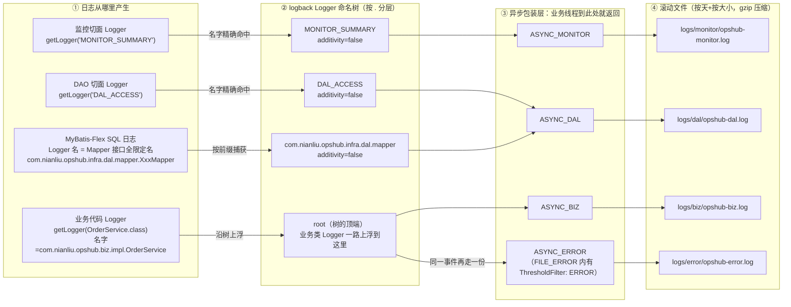
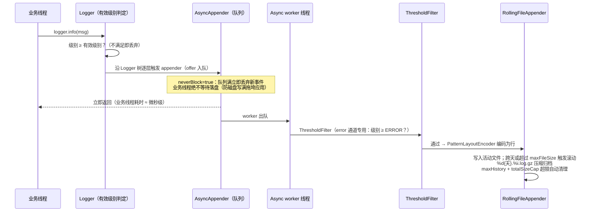

# OpsHub 日志通道设计说明

> **一句话回答标题里的问题**：一条日志会被写到哪个目录，**由它诞生时所用 Logger 的名字决定**——
> 名字命中了 XML 中声明的专属 Logger（`MONITOR_SUMMARY` / `DAL_ACCESS` / `com.nianliu.opshub.infra.dal.mapper`）
> 就进专属通道（**显式路由**）；名字没有命中的，事件会沿 Logger 命名树一路向上"漂"到
> root Logger，被 root 挂着的 `ASYNC_BIZ` 兜底接收（**隐式路由**）；最后再按级别 ERROR 做一层"复制"进错误通道。
> 下面把这套机制从原理到用法完整讲清。

---

## 一、总览：路由全景图



**四通道速查表**：

| 通道目录 | 收什么 | 分流判据（路由"开关"） | 输出者 |
| --- | --- | --- | --- |
| `logs/biz/` | 全部业务明细 | **没有命中任何专属 Logger** → 上浮至 root | root 的 `ASYNC_BIZ` |
| `logs/monitor/` | 接口监控摘要（切面聚合） | **Logger 名精确等于** `MONITOR_SUMMARY` | 该命名 Logger（additivity=false） |
| `logs/dal/` | DAO 切面埋点 + SQL 明细 | **Logger 名精确等于** `DAL_ACCESS`，或**前缀属于** `com.nianliu.opshub.infra.dal.mapper` | 该前缀 Logger（additivity=false） |
| `logs/oplog/` | **操作审计**（@OpsLog 切面产出的结构化 JSON） | **Logger 名精确等于** `OP_LOG`；仅由 `DefaultOpsLogService` 写入，业务代码禁止手工输出 | 该命名 Logger（additivity=false，60d 长留） |
| `logs/error/` | 全部 ERROR 级别的复制档 | **级别** ≥ ERROR（无论来自哪个通道） | root 的 `ASYNC_ERROR`（阈值过滤） |
| 控制台 | 开发环境全量 | `springProfile=dev` 时 root 才挂 `CONSOLE` | root 的 `CONSOLE` |

> 操作审计通道的注解声明、模板语法、字段级 diff 机制与前置取数契约，
> 见《[REA分析-操作日志与SpEL校验](REA分析-操作日志与SpEL校验.md)》——
> 该通道内容是审计证据（完整性 100% 红线），与排障日志的保留策略与治理口径不同。

---

## 二、核心机制：logback 是按"Logger 名字树"分流的

### 2.1 所有 Logger 共处一棵按名字切分的树

logback 中**每个 Logger 就是一个字符串名字**，名字里的每个 `.` 切出一层父子：

```text
root                       ← 树根，XML 里的 <root>
└── com
    └── nianliu
        └── opshub
            └── biz
                └── impl
                    └── OrderController   ← getLogger(OrderController.class) 产生
            └── infra
                └── dal
                    └── mapper            ← XML 中声明为专属 Logger（拦截点）
                        └── UserMapper   ← MyBatis-Flex 打 SQL 日志用的名字

MONITOR_SUMMARY            ← 名字里没有点，直接挂在 root 下面
DAL_ACCESS                 ← 同上
```

两个关键事实：

1. **类名 Logger 名字就是类全限定名**——`LoggerFactory.getLogger(OrderService.class)` 与 `getLogger("com.nianliu...OrderService")` 等价；
2. **命名 Logger 不需要是任何类名**——`getLogger("MONITOR_SUMMARY")` 一样合法，它是纯粹的"路由暗号"：代码里用的名字与 XML 里 `<logger name="...">` 的名字对上号，事件就被引到专属通道。

### 2.2 一条日志事件的传播规则（决定目录的物理机制）

Logger 打一条日志时，logback 做两件事：

**第一件：级别判定（决定"过不过"）**

用该 Logger 的**有效级别**过滤。有效级别的取法是：自己在 XML/yml 里设了就用自己设的；没设就**沿树向上找最近的设了级别的祖先**；都没有则用 root 的。这就是为什么业务代码平时**不需要任何配置**——它们全部继承 root 的 `INFO`。

> 级别判定的优先级高于通道路由：级别不够，事件根本不会产生，谈不上进哪个目录。

**第二件：Appender 累积传播（决定"进哪个目录"）**

事件通过级别判定后，**从产生它的 Logger 出发，沿树向上逐层触发 appender**：

```text
OrderService.info("...") 
  → OrderController 这一层：XML 没配置，身上没有 appender  → 继续
  → impl / biz / opshub / nianliu / com 各层：同样没有       → 继续
  → root：<appender-ref ASYNC_BIZ/>、<appender-ref ASYNC_ERROR/>
       → 事件被写入 biz 通道（并接受 error 通道的级别过滤）
  → 到达 root 后传播结束
```

传播在两种情况下停止：

1. **爬到 root（树顶）**——自然结束；
2. **中途遇到 `additivity="false"` 的节点**——在该节点的 appender 触发完就停止，**不再继续上浮**。

`additivity="false"` 就是"通道隔离阀"：`MONITOR_SUMMARY` 的事件只触发 `ASYNC_MONITOR`，被拦截不再飘到 root——否则监控摘要会再复制进 `logs/biz/` 一份，明细和摘要混流，通道就白分了。

### 2.3 三种分流方式总结

| 分流方式 | 通道 | 机制要点 |
| --- | --- | --- |
| **兜底式（隐式）** | biz | 业务 Logger 无专属配置 → 上浮到 root，被 root 的 `ASYNC_BIZ` 接住 |
| **命名式（显式）** | monitor / dal | 代码用约定名字取 Logger，精确命中 XML 声明的节点；`additivity=false` 保证只进专属通道 |
| **前缀式（显式）** | dal（SQL 部分） | XML 声明包级 Logger `com.nianliu.opshub.infra.dal.mapper`，该包下任意 Mapper 的 Logger（名字更长）向上传播时**必然路过这个节点**，被它捕获 |
| **级别式（复制）** | error | 不设新路由，`ASYNC_ERROR` 同样挂在 root 上；靠 `FILE_ERROR` 内部 `ThresholdFilter(ERROR)` 只放行 ERROR 及以上 |

---

## 三、四个通道逐一拆解

### 3.1 业务明细 `logs/biz/` —— "谁都没认领的日志归这里"

```java
// 业务代码：与普通项目写法完全一致，零额外约定 —— 正是设计意图：
// 开发者不需要理解通道路由，写日志的"缺省行为"就是落业务明细
private static final Logger logger = LoggerFactory.getLogger(OrderService.class);

logger.info("受理成功@submitOrder 单号:{}", orderNo);   // → logs/biz/
```

路由过程：`com.nianliu.opshub.biz.impl.OrderService` 这条链上没有任何 XML 声明 → 一路上浮到 root → root 在 `dev` 环境挂了 `CONSOLE + ASYNC_BIZ + ASYNC_ERROR`（test/prod 挂 `ASYNC_BIZ + ASYNC_ERROR`）→ **同一事件并发送进三个 appender**，其中 `ASYNC_BIZ` 写 `logs/biz/`。

### 3.2 监控摘要 `logs/monitor/` —— "接口层零手写日志，摘要全部由切面产生"

```java
// 业务监控切面（启动装配层 aspect 包）——名字即路由：
private static final Logger MONITOR = LoggerFactory.getLogger("MONITOR_SUMMARY");

// 出口打一条聚合摘要（不用 Logger 名做内容，靠内容键值化便于统计）
MONITOR.info(String.format("ACCEPT|order.submit|status:%s|cost:%dms|%s", status, cost, traceId));
// → 只进 logs/monitor/，additivity=false 阻断其继续飘向 root / logs/biz/
```

设计动机（编码规范 §18.3 / §18.4）：接口层**零手写日志**，出口统一由切面打"流量摘要"；摘要与明细分文件，聚合数据不会淹没在高频明细里，磁盘成本也分开治理。

### 3.3 数据访问 `logs/dal/` —— "一个通道、双入口"

```java
// 入口①：DAO 监控切面（自动埋点：类名/方法/入参/耗时）
private static final Logger DAL = LoggerFactory.getLogger("DAL_ACCESS");
DAL.info(String.format("UserRepository|findById|id:%s|cost:%dms", id, cost));
```

入口② 不需要写任何代码——**MyBatis-Flex 的 SQL 日志自动流入此通道**：

- MyBatis 体系（MyBatis-Flex 完整继承）在执行 SQL 时，以 **Mapper 接口的全限定名** 作为 Logger 名（即 `statement id` 的 namespace），向其输出 `Preparing:SELECT...`（SQL）、`Parameters: ...`（参数）、`Total: ...`（行数）三类 debug 级日志；
- 我们的工程契约是：**所有 Mapper 接口必须放在 `com.nianliu.opshub.infra.dal.mapper` 包下**（编码规范 §2.4：数据访问能力唯一归属 dal 模块）；
- 于是 SQL 日志的 Logger 名必然形如 `com.nianliu.opshub.infra.dal.mapper.UserMapper`——向上传播时被 XML 中声明的包级 Logger `com.nianliu.opshub.infra.dal.mapper` 捕获 → `ASYNC_DAL` → `logs/dal/`，`additivity=false` 不再外溢。

**SQL 看不看的总闸是级别**：XML 给该节点 `level="INFO"`（默认关 SQL——MyBatis 的 SQL 日志是 debug 级，INFO 门槛下全被拦）；`application-dev.yml` 中 `logging.level.com.nianliu.opshub.infra.dal.mapper: debug` 运行期把这个节点的级别改到 DEBUG → SQL 明细开放（仍只进 dal 通道）。test/prod 保持 Info，SQL 不落盘。

### 3.4 错误明细 `logs/error/` —— "不设路由，只按级别复制"

```xml
<!-- 所有 ERROR 级事件的复制通道：不新开路由，appender 内做级别过滤 -->
<appender name="FILE_ERROR" ...>
    <filter class="ch.qos.logback.classic.filter.ThresholdFilter">
        <level>ERROR</level>   <!-- 级别 ≥ ERROR 的事件才写 -->
    </filter>
```

一条 ERROR 事件（不管它是业务代码、切面还是框架打的）会**同时出现在两个文件里**：

- `logs/biz/`（或其原属通道）——事件按正常路径落档，**上下文完整**（前后有成百上千行明细连环）；
- `logs/error/`——经由 root 的 `ASYNC_ERROR` → 阈值过滤后**复制出一份纯错误流水**，值班同学只 tail 这一个文件就能盯住全站错误，不用在四个目录间跳跃。

这就是"复制"语义：错误通道**不是改路由**，而是**多挂一路接收者**。代价是错误日志约占双份磁盘，因此错误通道的滚动上限（100MB/60 天/2GB）是四通道中最克制的。

---

## 四、一条日志从代码到磁盘的完整旅程



**异步层的三个参数纪律**（防 §18.3.1"日志打爆磁盘拖垮服务"事故）：

| 参数 | 值 | 含义 |
| --- | --- | --- |
| `queueSize` | 1024 / 512 | 每通道内存队列容量（业务通道更大：明细流量高） |
| `discardingThreshold` | 0 | logback 缺省在队列余量 20% 时主动丢 debug 事件——置 0 是不让"半满就开始静默降级"，容量没到极限前一条不扔 |
| `neverBlock` | true | 队列**满**之后的行为：丢弃新事件立即返回 vs 阻塞业务线程等位。选前者——**宁可丢几条日志，不能拖慢一次业务请求**；写满意味着磁盘层已故障，此时丢日志是正确降级 |

**滚动文件机制**（`SizeAndTimeBasedRollingPolicy`）：

```text
logs/biz/opshub-biz.log                      ← 当天活动文件（<file> 指定）
logs/biz/opshub-biz.2026-11-16.0.log.gz      ← 首次滚动：日期 + 当日序号 %i + gzip 压缩
logs/biz/opshub-biz.2026-11-16.1.log.gz      ← 当天单文件超 200MB 再切
```

清理双保险：`maxHistory`（最多保 30 份天级归档）+ `totalSizeCap`（通道总量超 5GB 连带删旧）+ `cleanHistoryOnStart`（启动即清理上次异常残留）。

---

## 五、目录根在哪儿？——环境决定（与 XML 解耦）

XML 中只写 `${LOG_HOME}`（= `${LOG_PATH:-./相对}`），**目录根由 Spring 层**逐屏提供**：

| 环境 | 日志根目录 | 供给方式 |
| --- | --- | --- |
| dev | **工程根 `/logs`** | `application-dev.yml: logging.file.path` → Spring 把该值注入为系统属性 `LOG_PATH` → XML 的 `${LOG_HOME}` 拾取。开发目录经 Maven 资源过滤在构建期固化为绝对路径——**IDEA / 命令行在任意目录启动，日志都钉死在工程根** |
| test | `${LOG_PATH:./logs}` | 部署系统环境变量注入（日志盘） |
| prod | `${LOG_PATH}`（无缺省） | 必填注入——缺变量**启动即失败**（fail-fast，禁止应用随意散落日志） |

`springProfile` 同时处理 root 装配差：dev 额外挂 `CONSOLE` 彩色控制台；test/prod 只落盘，并对 `org.springframework` / `com.zaxxer.hikari` / `io.lettuce` 等三方框架降到 WARN 降噪。

---

## 六、给开发者的使用契约（速查）

**写业务日志（99% 的场景）**——没有任何新东西要学：

```java
private static final Logger logger = LoggerFactory.getLogger(XxxService.class);
logger.info(String.format("受理成功@submitOrder 单号:%s", orderNo));
// → logs/biz/（dev 下同时上控制台）
```

**监控摘要**（仅启动装配层切面使用）：

```java
private static final Logger MONITOR = LoggerFactory.getLogger("MONITOR_SUMMARY");
```

**数据埋点**（DAO 切面；名字若打错=摘要漏检，务必常量声明避免手滑）：

```java
private static final Logger DAL = LoggerFactory.getLogger("DAL_ACCESS");
```

注意事项（违反即破坏通道隔离）：

| # | 规则 | 违反后果 |
| --- | --- | --- |
| 1 | `MONITOR_SUMMARY` / `DAL_ACCESS` / 包级 mapper 三处改名要同步（XML+使用方+本文档） | 事件脱靶 → 悄悄落进 logs/biz/，摘要/审计断流 |
| 2 | Mapper 接口必须放 `com.nianliu.opshub.infra.dal.mapper` 包 | SQL 日志脱靶 → 落进 logs/biz/ 污染业务通道 |
| 3 | 业务代码**不要**私自 `getLogger("MONITOR_SUMMARY")` 打正式日志 | 明细/摘要混流，拖垮摘要通道的剂量管控 |
| 4 | 通道名大小写敏感（`ASYNC_MONITOR` ≠ `ASYNC_Monitor`） | appender-ref 报未定义错（启动期会报，运行期不会沉默） |
| 5 | `OP_LOG` 通道名在 logback-spring.xml 与 `DefaultOpsLogService` 两处同源；操作日志**只经 @OpsLog 切面**产出，业务代码禁止手工 getLogger("OP_LOG") | 审计 JSON 行格式被手写文本污染，下游审计表/日志平台解析断流 |

---

## 七、常见问题（FAQ）

**Q1：为什么同一条 ERROR 在 biz 和 error 两个文件里都有？**
不是 bug，是层的**复制语义**：`ASYNC_ERROR` 也挂在 root 上，接收所有上浮事件，但 `FILE_ERROR` 内部 `ThresholdFilter(ERROR)` 只放行错误级别——专门给值班同学一张"纯错误流水"视图，同时 biz 保留错误前后的完整上下文明细（真正排障还是要看 biz）。

**Q2：为什么我的 SQL 明细看不到（dev 环境）？**
三查：① `Mapper` 是否在 `com.nianliu.opshub.infra.dal.mapper` 包（不在此包→脱靶漂进 biz）；② `logging.level.com.nianliu.opshub.infra.dal.mapper` 是否开到 `debug`（`${appName}-dal.log` 只收 §3.3 双入口的量）；③ MyBatis-Flex `print-banner` 无关、`cache-enabled:false` 无关——别被这两个带偏。

**Q3：丢了日志怎么办？neverBlock 不可接受？**
按 §18.3.1 的事故复盘定位：`neverBlock=true` 只在**队列写满**时成立，正常不存在峰值丢失；队列写满本身等价于"磁盘或写入层故障"，此时阻塞业务线程会把故障从"日志系统"扩大为"全服务不可用"。四通道异步 + 双上限治理就是为了让"满"不发生：如果发现有日志丢弃，该排查的是磁盘 I/0 与滚动清理健康度，而不是把 `neverBlock` 改回 false（那等于把日志故障转嫁给业务面）。

**Q4：为什么 XML 将 monitor 的 logger 级别设为 INFO、我又临时想打到 DEBUG 快速观测？**
XML 的 `level` 可被 Spring Boot 的 `logging.level.*` **运行期覆盖**（优先级最高），无需改 XML、无需重启日志系统：`--logging.level.MONITOR_SUMMARY=debug` 启动参数即刻生效。

**Q5：traceId 那一列怎么填进去的？**
行格式 `%X{traceId:-}` 从 **MDC**（Mapped Diagnostic Context，线程本地 map）取：入口切面 `MDC.put("traceId", ...)`, 当前请求下所有日志行（跨 biz/monitor/dal 通道）都自动带同一标识——全链路串联（编码规范 §18.9），未设置时显示占位符 `-`。

---

## 八、设计依据（与编码规范条款对照）

| 规范条款 | 本设计的落点 |
| --- | --- |
| §18.4 异步分通道（业务明细 / 监控摘要 / 数据访问） | 一目了然的四目录 + 通道命名 Logger 契约 |
| §18.3.1 磁盘保护（滚动 + 双上限 + 不阻塞业务线程） | neverBlock + discardingThreshold=0 + maxHistory/totalSizeCap |
| §18.3 分层打点（接口实现层零手写；数据访问层切面记录） | `MONITOR_SUMMARY` / `DAL_ACCESS` 命名 Logger + mapper 包约定 |
| §18.9 TraceId 全链路透传 | `%X{traceId:-}` + MDC |
| §2.7.1 业务监控切面、数据访问监控切面双切面归属启动装配层 | 两个命名 Logger 的消费方即两个切面（aspect 包） |
| §2.5 同能力唯一实现（日志门面唯一、实现唯一） | slf4j-api 门面（common 收敛）+ logback 唯一实现（Enforcer bannedDependencies 兜底） |

---

**配置与实现的单点事实**：以上全部行为的实现位于 `opshub-bootstrap/src/main/resources/logback-spring.xml`；修改任何通道的容量、级别、保留期请改该文件并在本文档同步记录变更。

---

## 九、日志打印的耗时治理

日志不是免费的。前八章回答"日志去哪儿"，这一章回答"每一行日志让请求慢了多少"——并给出 OpsHub 的现状自检与现实约束。方法论依据《编码规范》§18.10（三段耗时链路：参数求值 / 格式化装配 / 输出落盘——**异步只解决了第三段**）。

### 9.1 耗时发生在哪：一段话讲透

调用方线程的真实开销 = **参数求值（拼接/序列化/toString）+ 格式化装配 + 异步入队**；落盘由 worker 线程承担。

```java
// 生产接口里一次真实的 "日志耗时" 分解：
logger.info("instances:" + JSON.toJSONString(list) + " cost:" + watch.getTotalTimeMillis());
//                    ↑ 第①段：序列化（万级集合可达毫秒级—— 队头大兽）
//        ↑ 第②段：占位/格式化（µs 级）
//                                             ↑ 第③段：入队（µs 级）→ 之后落盘与业务线程无关
```

关键结论：**关掉日志级别省不掉第①段**（Java 求值先于方法调用），只有"级别守卫 + 廥参数"才能省。日志拖慢接口的事故大多在第①段，与异步管道无关。

### 9.2 OpsHub 管道现状自检（对照规范 §18.10.3）

| 规范要求 | OpsHub 现状 | 结论 |
| --- | --- | --- |
| 业务线程只入队、落盘全异步 | 四通道全部经 `ASYNC_*` 包装（图四） | ✅ 已达标 |
| 队列满不阻塞业务 | `neverBlock=true` + `discardingThreshold=0`（§四参数表） | ✅ 已达标 |
| 不取调用位置 | `FILE_PATTERN` 只用 `%d/%level/%thread/%X/%logger/%msg`，**未用** `%class`/`%method`/`%line`；AsyncAppender 保持缺省 `includeCallerData=false` | ✅ 已达标（新增 pattern 时禁引入调用位置转换器） |
| 级别可热调 | XML 级别均可被 `logging.level.*` 运行期覆盖（§七 Q4） | ✅ 已达标 |
| 异常堆栈纪律 | ERROR 通道长留档案设计隔离了高频刷屏（§三 3.4）；业务预期分支 warn 不带堆栈 | ✅ 设计达标，靠业务代码自觉遵守 |

### 9.3 OpsHub 代码使用规则（阶段②开发起生效）

运维平台的典型日志场景与对应约束：

| 场景 | 约束 |
| --- | --- |
| 实例巡检批量采样（循环遍历目标实例） | **循环外聚合一条**：总数/健康数/异常样例键。禁止循环内逐条 info |
| 目标实例在线查询的出入参 | 入参出参**禁止全量 JSON 序列化**（结果集可能是 MB 级）；打业务键+行数+耗时 |
| 临时排障观测日志 | 级别用 debug + 守卫包裹昂贵求值（§《编码规范》§18.10.2 规则 1）；用 `-Dlogging.level.XXX=debug` 热开，用完回收 |
| 高频路径（连接池探活、健康巡检心跳） | 连续运行的 checker 类逻辑 info 不逐次打，改走 monitor 通道摘要 + 异常时才升级 warn/error |
| 统一接入模板的出口摘要（阶段②） | LogInfo 值对象**暂存引用**，命中级别才序列化（延迟序列化，规范 §18.10.2 规则 3） |
| 大对象明细开关 | 切面注解声明 `detailedArguments/detailedResult`，高频接口缺省关（规范 §18.10.2 规则 2） |

### 9.4 耗时预算（写入验收口径）

| 项 | 预算 | 含义 |
| --- | --- | --- |
| 单条异步入队耗时 | 稳定 µs 级 | 打印一次日志的调用方开销 |
| 日志对接口 RT 的贡献 | **< 1%** | 阶段②接口压测时核对（含附件：巡检批量、在线查询类） |
| 队列丢弃计数 | 常态 = 0 | 非零即落盘端.capacity 异常的前兆，应触发告警（观测项，见 9.5） |

### 9.5 演进备忘（量级信号触发才做）

| 信号 | 动作 |
| --- | --- |
| 通道名 "手滑打成错名" 造成漂移事故 | 通道名（`MONITOR_SUMMARY` / `DAL_ACCESS` / mapper 包）从字符串升级为**常量类集中声明**，与 logback-spring.xml、本手册三方同源（规范 §18.10.4 规则 2） |
| 异步队列频繁逼近满 | 排查磁盘 I/O；再评估切 log4j2 AsyncLogger（无锁环形缓冲，吞吐高一个量级）或收紧通道级别 |
| 队列水位/丢弃行为不可见 | 在启动装配层预热带一个轻量观测器（挂 JMX 或定期 dump AsyncAppender 状态） |

> 一句话收口（规范 §18.10.6）：**异步只保落盘不阻塞，守卫才保求值不白跑**——OpsHub 管道端已达标，剩下的耗时纪律在每一行业务代码的参数求值里。
